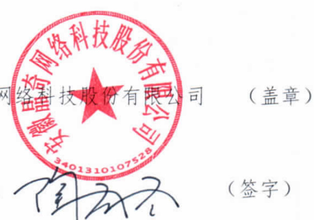

# 技术服务协议书  

项目名称：数据资源及案例管理系统项目委托方（甲方）：民政部低收入家庭认定指导中心服务方（乙方）：安徽晶奇网络科技股份有限公司  

根据民政部低收入家庭认定指导中心数据资源及案例管理系统项目的采购结果，按照《中华人民共和国政府采购法》、《中华人民共和国合同法》的规定，经双方协商，本着平等互利和诚实信用的原则，一致同意签订本合同如下。  

# 一、合同金额  

合同金额为（大写）：一人民币贰拾万元整(￥200,000.00元）。  

# 二、服务范围及时间  

本合同项下的服务指为满足项目招标文件需求所提供的所有服务（详见附件）：  

# （一）建设期  

（1）结合部中心课题成果建设数据资源及案例管理系统，提供资源目录模块和案例库模块。通过资源目录模块收集录入整理各地可共享的信息资源，及时更新和发布全国数据资源目录，评估各地信息资源的更新效率、作用发挥、关联关系等指标，协作修订相关标准规范；通过案例库模块整理录入地方政策和案例，定期通过线上收集整理，及时把有效案例发布在平台上，与数据资源目录中的相关数据项关联，展现数据应用场景。  

（2）项目开发周期不少于6个月，开发完成后乙方申请甲方验收，验收通过后进入免费维护期。  

# 技术服务协议书  

项目名称：数据资源及案例管理系统项目委托方（甲方）：民政部低收入家庭认定指导中心服务方（乙方）：安徽晶奇网络科技股份有限公司  

根据民政部低收入家庭认定指导中心数据资源及案例管理系统项目的采购结果，按照《中华人民共和国政府采购法》、《中华人民共和国合同法》的规定，经双方协商，本着平等互利和诚实信用的原则，一致同意签订本合同如下。  

# 一、合同金额  

合同金额为（大写）：、人民币贰拾万元整（￥200,000.00元）。  

# 二、服务范围及时间  

本合同项下的服务指为满足项目招标文件需求所提供的所有服务（详见附件）：  

# （一）建设期  

（1）结合部中心课题成果建设数据资源及案例管理系统，提供资源目录模块和案例库模块。通过资源目录模块收集录入整理各地可共享的信息资源，及时更新和发布全国数据资源目录，评估各地信息资源的更新效率、作用发挥、关联关系等指标，协作修订相关标准规范；通过案例库模块整理录入地方政策和案例，定期通过线上收集整理，及时把有效案例发布在平台上，与数据资源目录中的相关数据项关联，展现数据应用场景。  

（2）项目开发周期不少于6个月，开发完成后乙方申请甲方验收，验收通过后进入免费维护期。  

（3）提供至少1名技术人员现场驻点服务，可根据项目实际需求抽调团队1-4名技术人员提供驻场支持。  

（二）免费维护期  

（1）自项目验收后，提供一年的免费项目维护服务。服务内容包括但不限于本项目相关软件系统、数据库的维护以及配合课题持续深入而进行的其他活动。  

（2）免费维护期提供至少1名技术人员，可根据项目实际需求抽调团队1一4名技术人员提供驻场支持。  

（3）免费维护期提供9个月现场驻点服务，可根据项目实际情况适当延长驻场时间。  

# 三、双方权利和义务  

# （一）甲方的权利和义务  

（1）为保证按时按质完成项目，甲方指定王静同志担任项目负责人，并负责履行行业指导、内部协调、组织验收、跟踪服务，提供项目实施条件、项目联络审定等方面的义务。  

（2）甲方在乙方项目组进驻前，需做好项目实施前所需准备工作。  

（3）系统正常运行所需要的基础数据由甲方按照乙方制定的格式提供电子文档。  

（4）甲方在实施过程需配合乙方项目组人员进行项目实施。在项目实施过程中双方人员所产生的争议由双方指定负责人协商解决。  

（5）甲方有权对乙方提交的项目成果展开验收并提出修改意见。甲方收到乙方的验收申请和相关成果材料后，组织三名专家组成评审组，根据本协议附件记载的项目需求、招标文件和投标文件对本项目进行验收。验收未通过的，乙方应按照甲方提出的修改意见完成修改，修改期限由双方另行书面约定。  

（6）在项目实施过程中，甲方对乙方提供的软件有权以书面方式提出修改要求，最终修改要求需经甲方确定和认可。  

# （二）乙方的权利和义务  

（1）为保证按时按质完成项目，乙方指定陶冬冬同志担任项目负责任人，负责履行组织实施、技术培训、项目管理、质量管理、交接验收、跟踪服务、项目联络单编制等方面的义务。  

（2）乙方有义务按双方业务已确认的合同书及招投标文件内容，按相关程序和标准组织实施，以保障信息系统正常运行和使用。  

（3）乙方有义务保护甲方的运营机密，不能将项目中所掌握和了解的甲方数据和资料透露给第三方。  

（4）乙方应保证本项目的投标技术、服务或其任何一部分不会产生因第三方提出侵犯其专利权、商标权或其他知识产权而引起的法律和经济纠纷；如因第三方提出其专利权、商标权或其他知识产权的侵权之诉，则一切法律责任由乙方承担。  

# 四、付款方式  

由甲方按下列程序付款：  

签订合同后，甲方在5个工作日内支付合同金额的80%，乙方提交最终成果并经甲方验收通过后，甲方在10个工作日内支付合同金额的20%。  

# 五、知识产权归属  

本项目项下的所有服务成果的知识产权（包括但不限于著作权、专利权等），甲、乙双方一致同意归甲方享有，甲方有权不经乙方同意独立进行相关知识产权的申请。  

# 六、保密  

项目实施过程中至乙方正式向甲方交付技术文档资料时止，乙方必须采取措施对本项目实施过程中的数据、源代码、技术文档等资料保密，否则，由于乙方过错导致的上述资料泄密的，乙方必须承担一切责任。项目完成后，甲、乙双方均有责任对本项目的技术保密承担责任。  

（1）未经乙方事先书面同意，甲方不得将由乙方为本合同提供的条文、规格、计划、图纸、模型、样品或资料提供给与本合同无关的任何第三方，不得将其用于履行本合同之外的其它用途。即使向与履行本合同有关的人员提供，也应注意保密并限于履行合同所必需的范围。  

（2）除了合同本身之外，上款所列举的任何物件均是乙方的财产。如果乙方有要求，甲方在完成合同后应将这些物件及全部复制件还给乙方。  

# 七、违约责任  

（1）乙方提供的服务不符合采购文件、投标文件或本合同规定的，甲方有权拒收并解除本合同，乙方须向甲方归还已收到的款项，并按本合同总价的5%支付违约金。  

（2）乙方未能按本合同规定的时间交付成果/提供服务的，从逾期之日起每日按本合同总价3%的数额向甲方支付违约金；逾期15 天以上（含15天）的，甲方有权终止合同，要求乙方退返合同价款并支付违约金，并且给甲方造成的经济损失由乙方承担赔偿责任。  

（3）甲方无正当理由拒收接受服务，到期拒付服务款项的，申方向乙方偿付本合同总价5%的违约金。申方逾期付款，则每日按本合同总价的3%向乙方偿付违约金。  

（4）项目负责人发生变更的，变更方应至少提前15天以书面形式告知对方。因变更方未及时告知而造成己方或对方损失，或是使得项目进程受到影响的，应自行负责消除影响，并承担全部赔偿责任。  

（4）其它违约责任按《中华人民共和国合同法》处理。  

# 八、争端的解决  

合同执行过程中发生的任何争议，如双方不能通过友好协商解决，甲、乙双方一致同意向甲方所在地人民法院提起诉讼。九、不可抗力  

任何一方由于不可抗力原因不能履行合同时，应在不可抗力事件结束后1日内向对方通报，以减轻可能给对方造成的损失，在取得有关机构的不可抗力证明或双方谅解确认后，允许延期履行或修订合同，并根据情况可部分或全部免于承担违约责任。  

# 十、税费  

在中国境内、外发生的与本合同执行有关的一切税费均由乙方负担。  

# 十一、提交物  

# 1、数据资源管理  

收集录入整理的共享信息资源文件，评估及修订的指标及标准文件、资源目录相关数据模型文档以及数据资源管理源代码。  

# 2、案例汇编库  

收集录入整理的相关有效案例以及案例汇编库源代码。  

# 3、文档资料  

提交项目《需求规格说明书》、《详细设计说明书》、《数据库设计说明书》、《应用系统接口设计》、数据字典、《培训记录》《用户手册》。  

# 十二、其它  

（1）本合同所有附件、采购文件、投标文件、中标通知书均为合同的有效组成部分，与本合同具有同等法律效力。  

（2）在执行本合同的过程中，所有经双方签署确认的文件（包括会议纪要、补充协议、往来信函）即成为本合同的有效组成部分。  

（3）如一方地址、电话、传真号码有变更，应在变更当日内书面通知对方，否则，应承担相应责任。  

（4）除甲方事先书面同意外，乙方不得部分或全部转让其应履行的合同项下的义务。  

# 十三、合同生效：  

1）合同自甲乙双方法人代表或其授权代表签字盖章之日起生效。  

2）合同壹式_陆份，其中甲乙双方各执叁份。  

# 合同签署页  

# 家庭认  

托方（甲方）：民政部低收入家庭认定指导中心（盖章）  

委托方法定代表人：  

地址：北京市西城区广安门南街48号中彩大厦7层  
联系人：王静  
联系电话：010-56176622  
日期：2019年12月20日  

服务方（乙方）：安徽晶奇网  

  

地址：合肥市高新区创新大道2800号合肥创新产业园二期F区2幢  
开户银行：中国工商银行股份有限公司合肥科技支行  
账户名称：中国工商银行股份有限公司合肥科技支行  
银行账号：1302011919200904007  
联系人：陶冬冬  
联系电话：17756030418  
日期：2019年12月20日  

# 附件1：项目服务内容  

# （一）需求调研服务  

针对本项目采购需求，提供针对性的需求调研服务，通过需求调研与采购方共同完成本项目的需求确认，并形成《需求规格说明书》  

# （二）系统研发服务  

根据项目采购需求及部中心实际需求，提供项目范围内的系统研发服务，建设数据资源及案例管理系统，提供资源目录模块和案例库模块。通过资源目录模块收集录入整理各地可共享的信息资源，及时更新和发布全国数据资源目录，评估各地信息资源的更新效率、作用发挥、关联关系等指标，协作修订相关标准规范；通过案例库模块整理录入地方政策和案例，定期通过线上收集整理，及时把有效案例发布在平台上，与数据资源目录中的相关数据项关联，展现数据应用场景。  

# （三）驻点技术服务  

遵循采购方日常办公章程，派遣至少一名技术人员提供驻点技术服务，包括现场需求对接、系统演示、技术交流、技术培训、系统运维等技术支持服务以及配合本项目课题持续深入而进行的其他活动，并可根据项目实际需求增加1-4名技术人员提供驻场支持。  

（四）其他服务  

本附件未提及内容，以数据资源及案例管理系统项目投标文件为准。  