# 金民工程技术架构介绍及在脱贫攻坚中的成果运用  

民政部信息中心     王兴玲  

# 形势与挑战－社会背景  

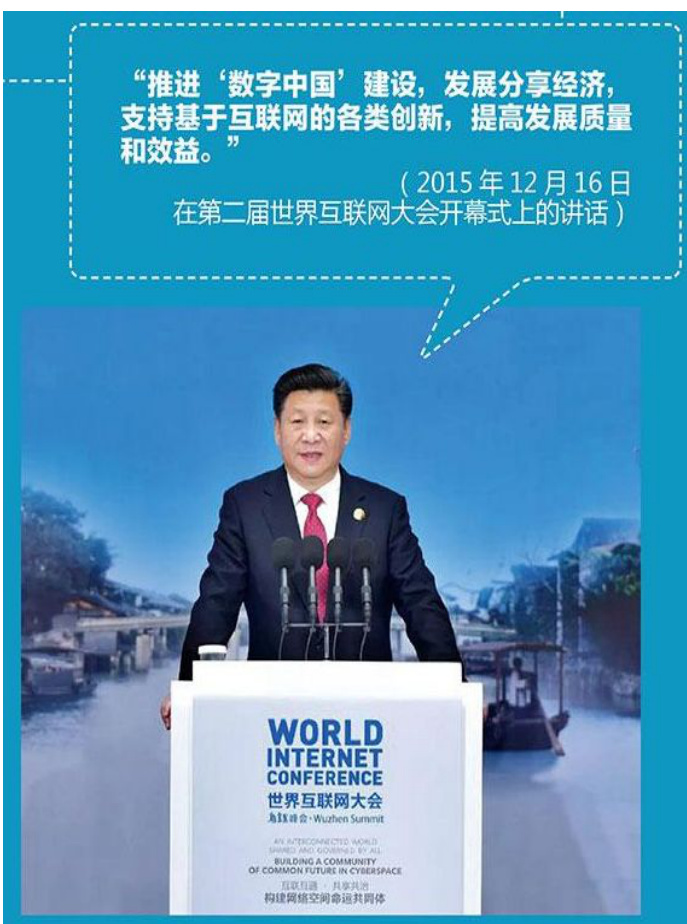  

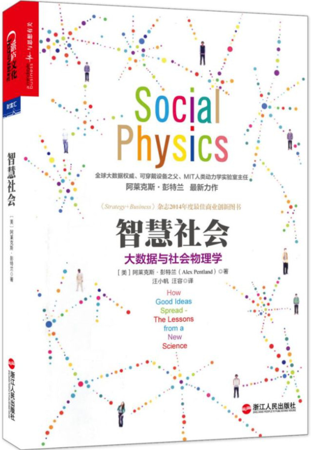  

# 形势与挑战－政府治理的新趋势  

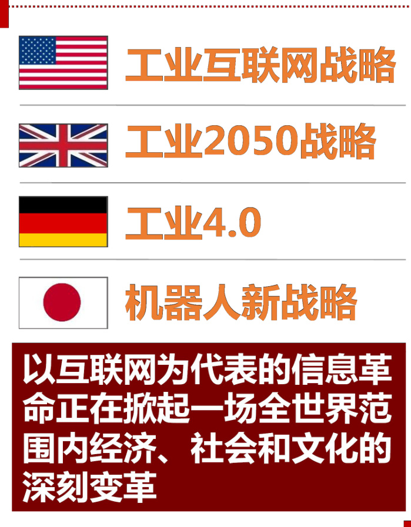  

  

在全球新一轮科技革命和产业变革中，互联网与各领域的融合已成为不可阻挡的潮流，“互联网+政务服务”成为互联网时代政府治理的新趋势  

# 形势与挑战－增强人民获得感  

要适应人民期待和需求，加快信息化服务普及，降低应用成本，为老百姓提供用的上、用得起、用得好的信息服务，让亿万人民在共享互联网收获成果上有更多获得感。  

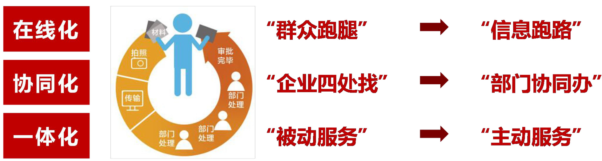  

某种意义上说，当前电子政务的主要矛盾是人民日益增长的政务服务需求与不平衡不充分的电子政务发展之间的矛盾。  

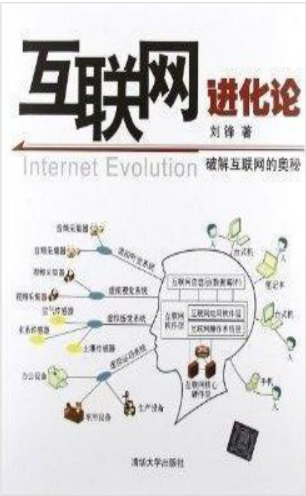  
形势与挑战－互联网的进化  

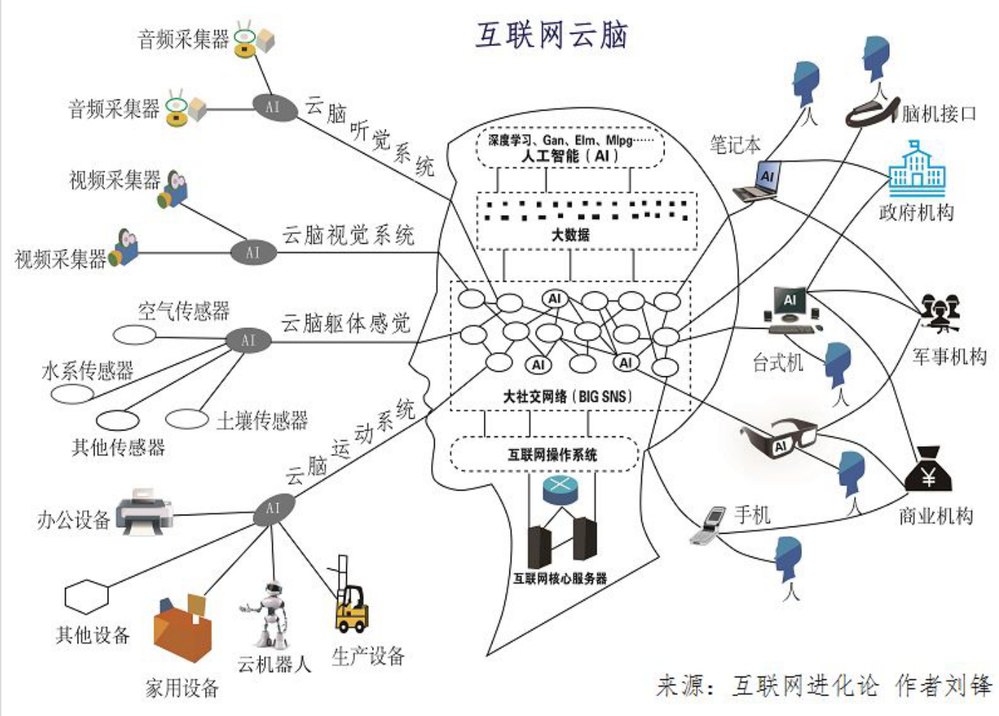  

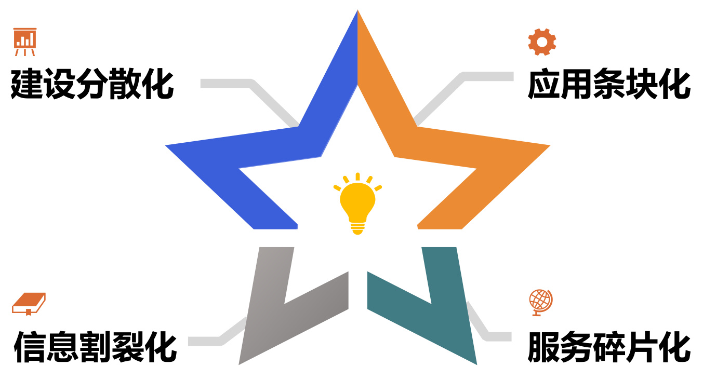  
形势与挑战－民政信息化存在的问题  

信息化建设“小、散、乱”正在逐步解决  

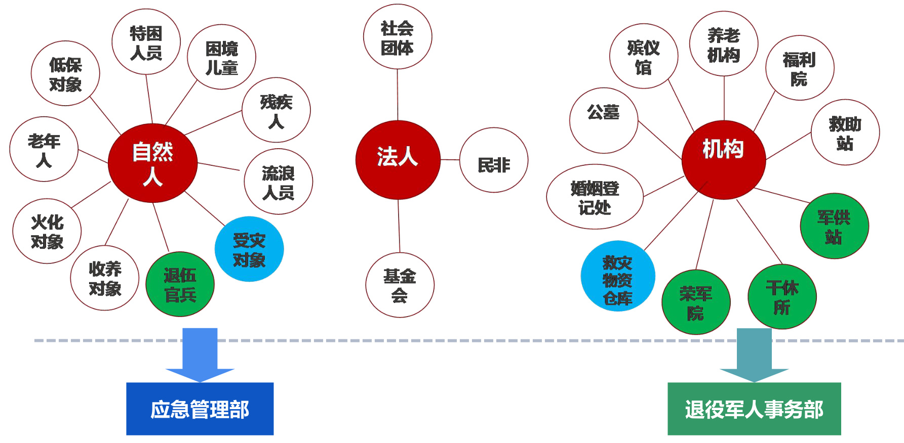  
形势与挑战－民政部门机构改革  

带来的变化：人少，机构少，信访少，急事少  

# 形势与挑战－新时期民政事业的定位  

民政工作关系民生、连着民心，是社会建设的兜底性、基础性工作。各级党委和政府要坚持以人民为中心，加强对民政工作的领导，增强基层民政服务能力，推动民政事业持续健康发展。各级民政部门要加强党的建设，坚持改革创新，聚焦脱贫攻坚，聚焦特殊群体，聚焦群众关切，更好履行基本民生保障、基层社会治理、基本社会服务等职责，为全面建成小康社会、全面建设社会主义现代化国家作出新的贡献。  

  

# 形势与挑战 －民政服务对象统一编码体系  

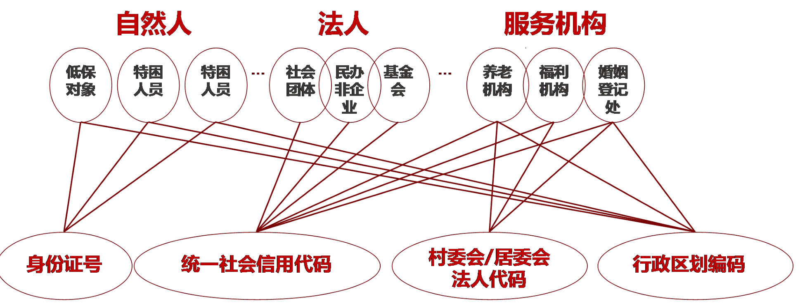  

# 形势与挑战 －民政服务对象的全链条、全生命周期管理  

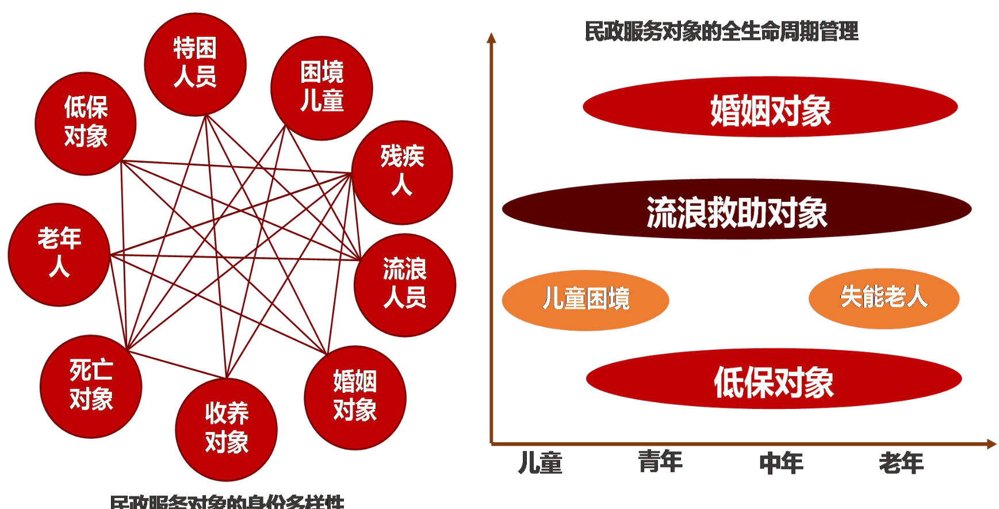  

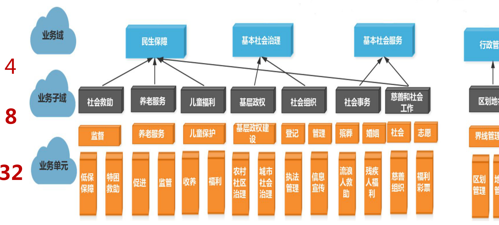  
形势与挑战－业务体系重构  

# 金民工程总体框架介绍  

  

  

# 金民工程总体框架－建设内容  

# 01_标准规范体系  

# 02_业务系统及应用支撑平台  

完善制定相关的业务流程、数据资源、交换接口等标准规范  

建设社会救助、社会福利与慈善、专项社会事务管理、公共服务与决策支持等5大业务系统和1个应用支撑平台  

# 03_民政信息资源数据库  

依托国家电子政务外网和全国统一的数据共享交换平台，实现民政部与省级民政部门，以及共建部门的互联互通和信息共享，建设民政信息资源库  

# 04_政务云服务平台  

# 05_机房配套工程  

构建云服务平台，提供统一的云服务，形成民政统一信息基础设施  

机房配套工程以及安全保障环境和运行维护系统  

# 金民工程总体框架－建设目标  

利用信息化手段，织牢织密基本民生兜底保障网，有效解决民生利益补给失信、服务供给不足以及民政信息化建设分散化、应用条块化、信息割裂化、服务碎片化等突出问题，促进民政信息化实现体系化、集约化、标准化、精准化的“一盘棋”布局，并通过金民工程全面推广应用，有效推动部省间平台互联、系统对接、数据共享、业务协同，实现民政信息化顶层设计与落地实施的分层对接。  

# 金民工程总体框架－建设模式  

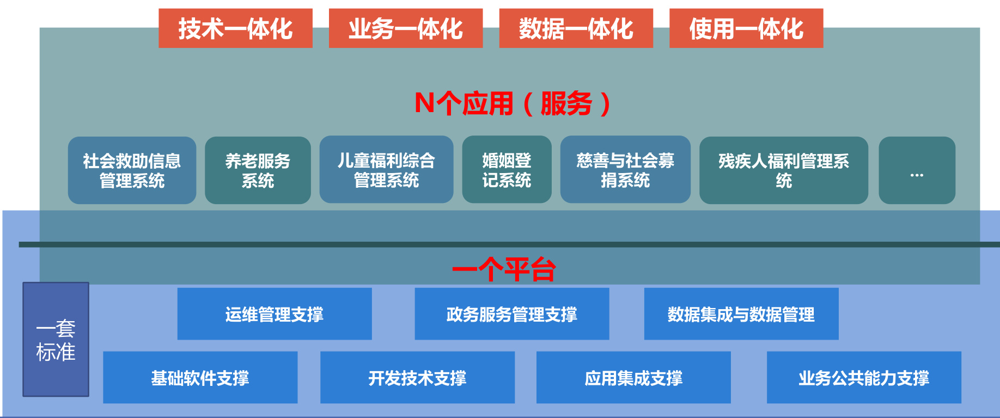  
1个平台+N个应用（服务）  

<html><body><table><thead><tr><td><b> </b></td><td><b>开放的系统架</b></td><td><b>开放的系统架</b></td><td><b>O</b></td><td><b>“</b></td><td><b>O</b></td></tr></thead><tbody><tr><td> </td><td>保障核心系统</td><td>标准化</td><td>标准化</td><td>一体化</td><td>国产化</td></tr><tr><td>智能化</td><td>弹性化</td><td></td><td>全国一盘棋 标准先进，维 护工程咨询， 以标准促统一</td><td>业务一体化 应用一体化 数据一体化 技术一体化 管理一体化</td><td>综合考虑各 种因素引入 符合要求的 国产产品</td></tr><tr><td> </td><td>智能增加系统 的智能化水平 广泛运用人工</td><td>功能快速扩展、 流程动态调整 各类资源灵活调 度 政策快速适应</td><td>开放的系统架</td><td>开放的系统架</td><td>开放的系统架</td></tr><tr><td> </td><td>系统设计符合</td><td>从当前和未来</td><td>保障核心系统</td><td>的工具集</td><td>先进性</td></tr><tr><td>开放性</td><td>安全性</td><td>经济性</td><td>可靠性</td><td></td><td>引入先进实用 的技术、设计 方法、管理方 法</td></tr></tbody></table></body></html>  

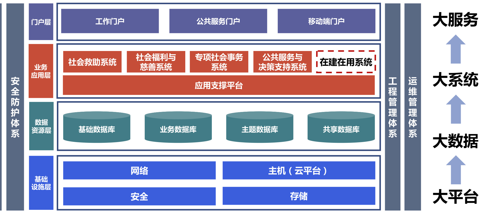  
金民工程总体框架－技术架构  

依据国家电子政务体系架构，金民工程一期项目采用“四横四纵”设计架构。  

# 金民工程总体框架－业务架构  

# 统一工作门户  

# 互联网公共服务门户  

# 移动端服务门户  

# 业务统一经办              业务统一受理  

# 社会救助  

•最低生活保障•特困人员供养 •临时救助  
•救助监管  
•救助绩效评价  

# 儿童福利  

•儿童收养   
•儿童救助  
•儿童福利  
•儿童保护  
•农村留守儿童关爱   
•农村留守妇女关爱   
•未成年人保护机构管理  

# 社会组织  

•社会团体服务与管理•基金会服务与管理•社会服务机构管理  

# 慈善社工  

•慈善服务  
•社会工作  
•志愿服务  
•福利彩票管理  

# 基层政务和社区治理  

•基层政权 •社区服务•社区治理  

# 养老服务  

•养老服务  
•老年人福利  
•养老服务机构管理•特困供养机构管理  

# 社会事务  

•婚姻登记  
•殡葬服务  
•残障人福利  
•福利机构管理  
•流浪救助  

# 区划地名  

•行政区划管理•地名管理•界桩界线管理  

# 规划财务  

•资金管理•发展规划•数据统计•资产管理  

# 综合  

•协同办公•教育培训•党群工作  

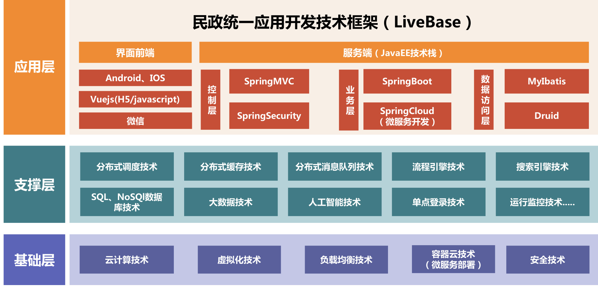  
金民工程总体框架－开发架构  
先进实用的业界主流技术选型  

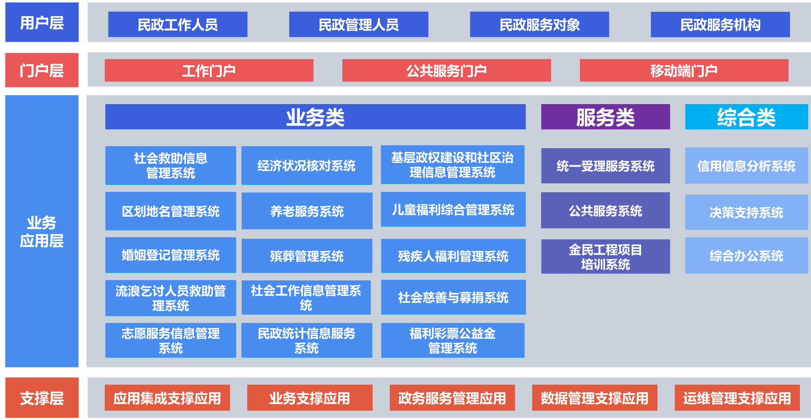  

# 金民工程总体框架－大平台设计  

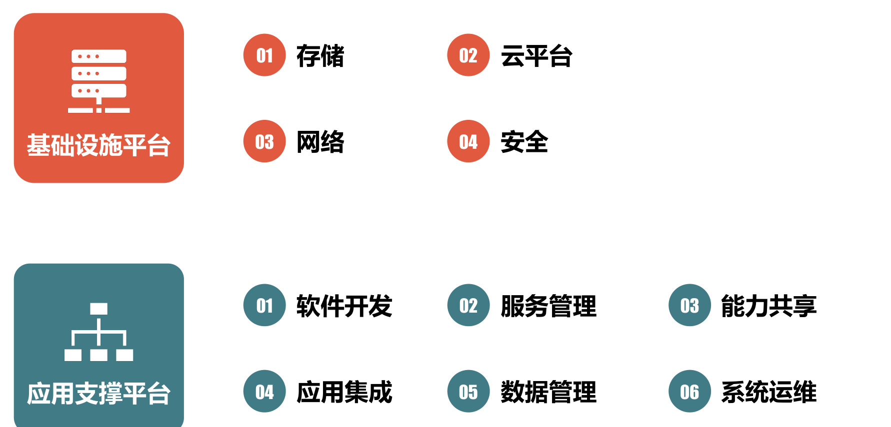  

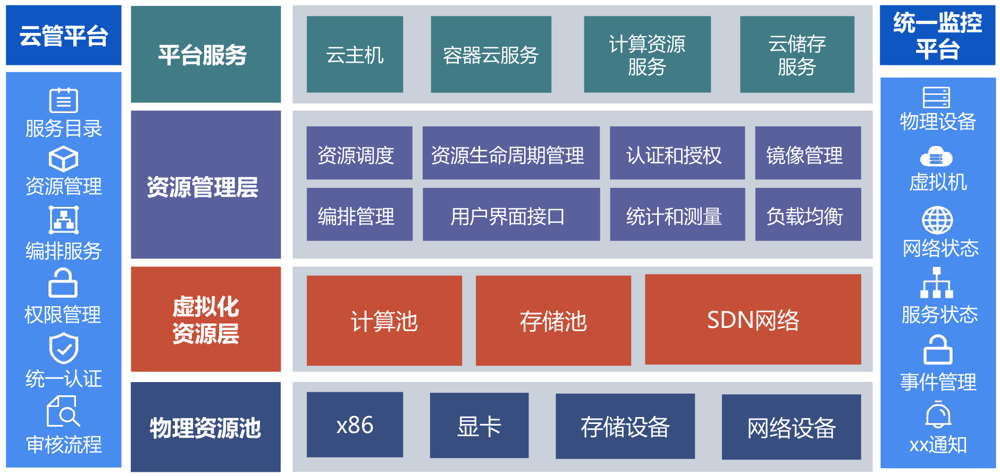  
金民工程总体框架－云服务平台架构  

# 金民工程总体框架－民政部政务云平台规模  

民政部政务云中心机房位于国家电子政务外网中心（廊坊）4A级机房，拥有148个机柜，分为互联网区和政务外网区，目前硬件支撑环境已搭建完毕。  

互联网区提供电信、联通和移动各300M互联网出口，共计900M带宽。互联网区可提供2464个虚拟CPU，1000TB的可利用数据存储空间。  

政务外网区提供1条500M的国家电子政务外网出口，政务外区提供1904个虚拟CPU，1000TB的可利用数据存储空间。  

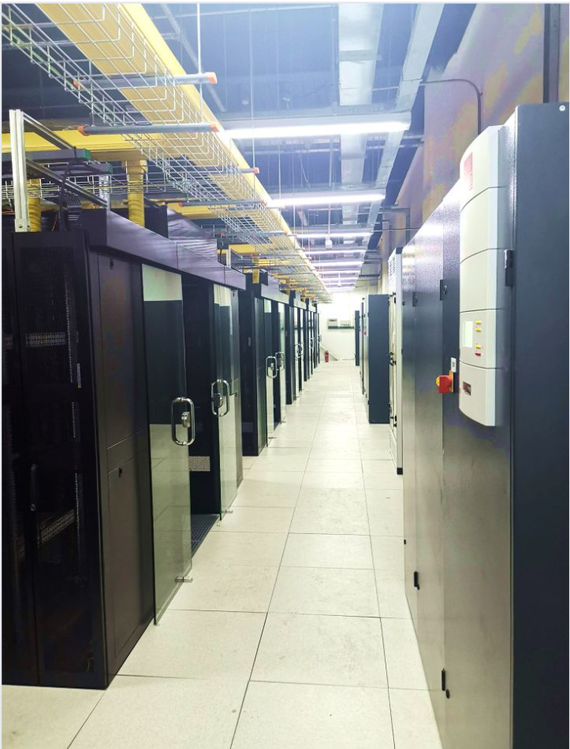  

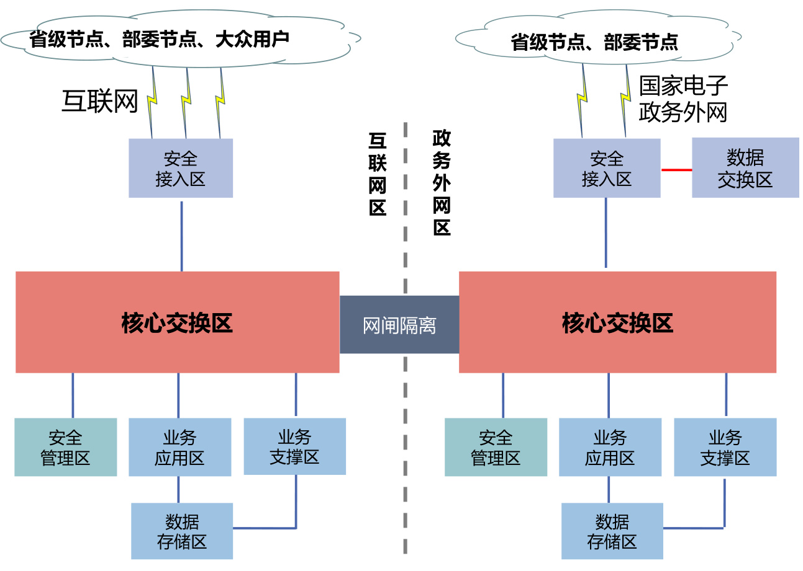  
金民工程总体框架－网络结构  
民政政务云平台的网络部署架构图  

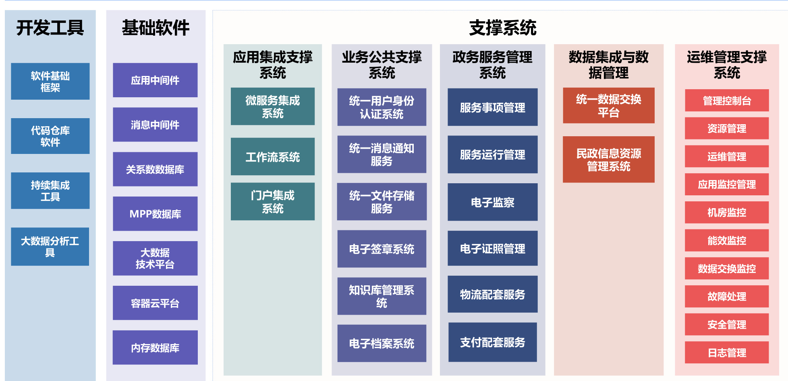  
应用支撑平台  

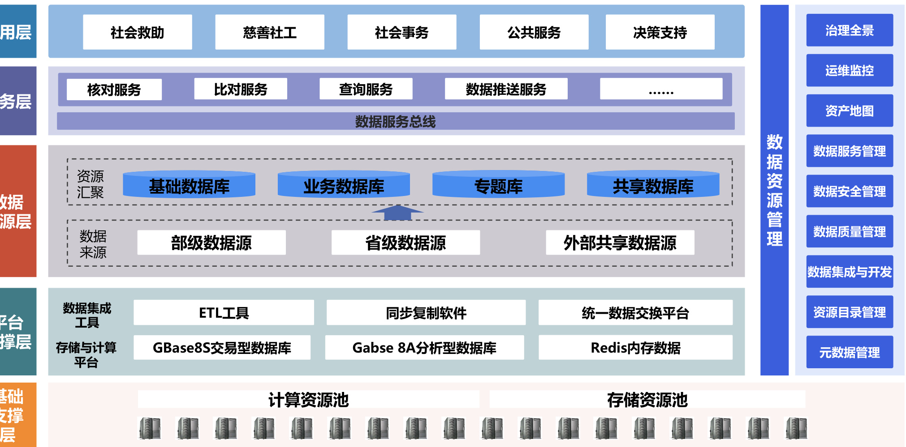  
金民工程总体框架－数据架构  

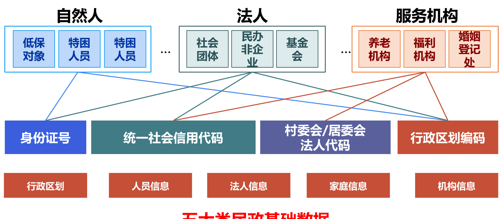  
金民工程总体框架－民政信息资源库（基础数据库）  
五大类民政基础数据  

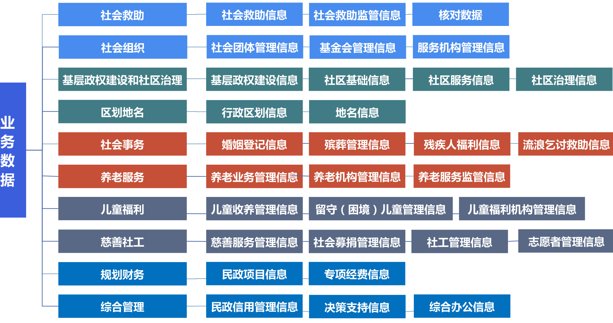  
金民工程总体框架－民政信息资源库（业务数据库）  

# 金民工程总体框架－民政信息资源库数据关联  

# 民政业务对象  

# 自然人自然人  

# 民政服务机构民政服务机构  

oo最低生活保障人员 最低生活保障人员   
oo特困供养人员特困供养人员  
oo临时救助人员临时救助人员  
oo儿童福利院入住人员儿童福利院入住人员  
oo孤儿基本生活费补贴人员孤儿基本生活费补贴人员  
oo困境儿童福利补贴人员困境儿童福利补贴人员  
oo留守儿童关爱人员留守儿童关爱人员  
oo困境儿童和孤残儿童保障人员困境儿童和孤残儿童保障人员  
oo未成年人社会保护人员未成年人社会保护人员  
oo被收养人/收养人/送养人被收养人/收养人/送养人  
oo困难残疾人生活补贴人员困难残疾人生活补贴人员  
oo重度残疾人护理补贴人员 重度残疾人护理补贴人员   
oo老年证持有人员老年证持有人员  
oo高龄津贴人员高龄津贴人员  
oo经济困难老年人养老服务补贴人员经济困难老年人养老服务补贴人员  
oo失能老年人养老护理补贴人员失能老年人养老护理补贴人员  
oo殡仪馆火化人员殡仪馆火化人员  
oo公墓安葬人员公墓安葬人员  
oo婚姻登记人员 婚姻登记人员   
oo流浪救助站救助人员流浪救助站救助人员  
oo社会工作者社会工作者  
oo志愿者志愿者  
oo特困人员供养机构特困人员供养机构  
oo儿童福利机构儿童福利机构  
oo养老机构 养老机构   
oo残障人福利机构残障人福利机构  
oo流浪救助站流浪救助站  
oo城市社区城市社区  
oo农村社区农村社区  
oo婚姻登记机关 婚姻登记机关   
oo殡仪馆殡仪馆  
oo公墓公墓  
oo社会工作机构社会工作机构  
oo社会工作培训机构社会工作培训机构  
oo志愿者服务组织志愿者服务组织  
oo慈善组织慈善组织  

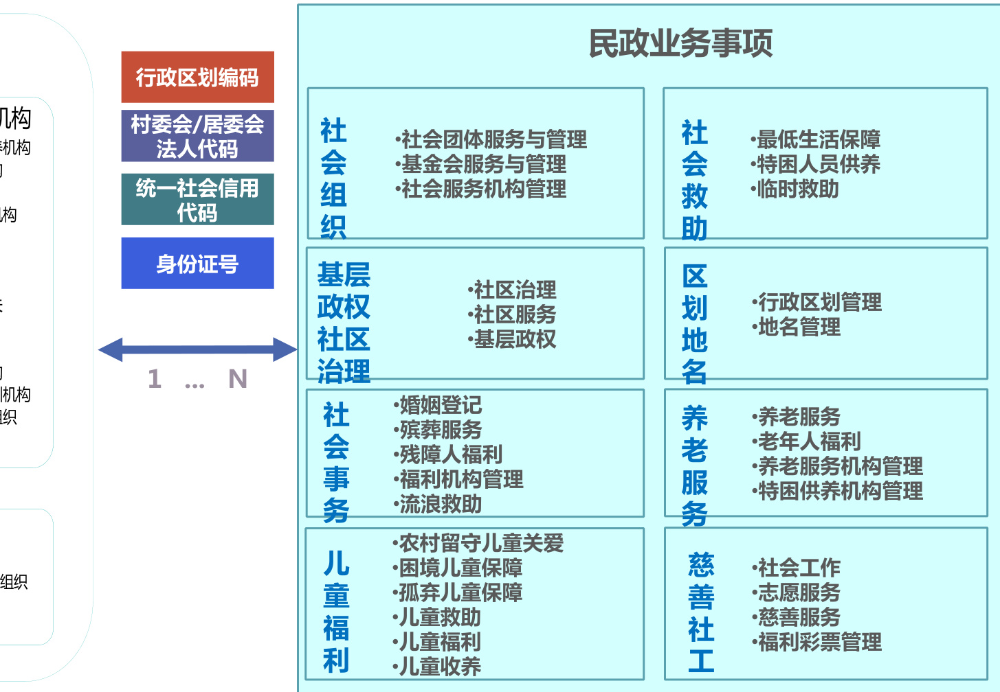  

# 金民工程总体框架－民政信息资源库（主题数据库）  

为构建民政相关业务全景分析、绩效评价、舆情扫描、精准推荐、信用评价、特征分析、预测预警、欺诈侦测、数据开放等大数据应用提供有组织、有条理、标准化的数据集合。  

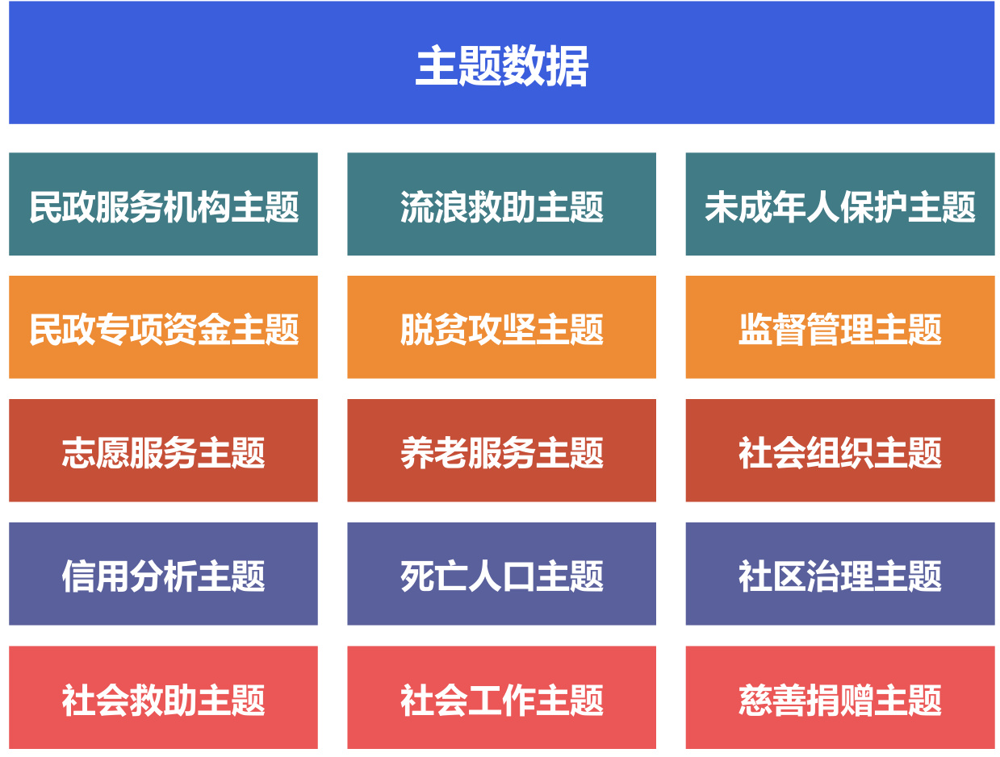  

金民工程总体框架－大系统设计  

<html><body><table><thead><tr><td><b>业务领域</b></td><td><b>包含的系统</b></td></tr></thead><tbody><tr><td>社会救助</td><td>（1）全国社会救助信息管理系统（社会救助管理系统、社会救助监管系统）（2）经济状况核对系统</td></tr><tr><td>基层政权建设 和社区治理</td><td>（1）全国基层政权建设和社区治理信息系统</td></tr><tr><td>区划地名</td><td>（1）区划地名管理系统（行政区划管理、地名管理）</td></tr><tr><td>社会事务</td><td>（1）全国婚姻登记管理系统（2）全国殡葬管理系统 （3）残疾人福利管理系统（4）流浪乞讨人员救助管理系统</td></tr><tr><td>养老服务</td><td>（1）全国养老服务系统（养老服务管理系统、养老机构内部管理系统、养老服务统计分析系统）</td></tr><tr><td>儿童福利</td><td>（1）全国儿童福利综合管理系统（儿童收养管理系统、留守困境儿童管理系统、儿童福利机构管理系统）</td></tr><tr><td>慈善社工</td><td>（1）社会慈善与募捐系统（慈善组织年报年检系统、慈善中国系统） （2）社会工作信息管理系统（3）志愿服务信息管理系统</td></tr><tr><td>规划财务</td><td>（1）民政统计与信息服务系统（2）福利彩票公益金管理系统</td></tr></tbody></table></body></html>  

# 金民工程总体框架－全国婚姻登记管理系统  

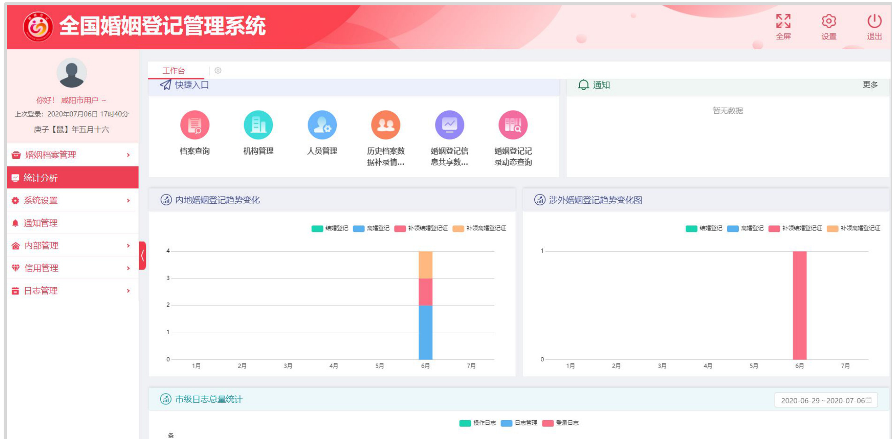  

# 金民工程总体框架－全国儿童福利综合管理信息系统  

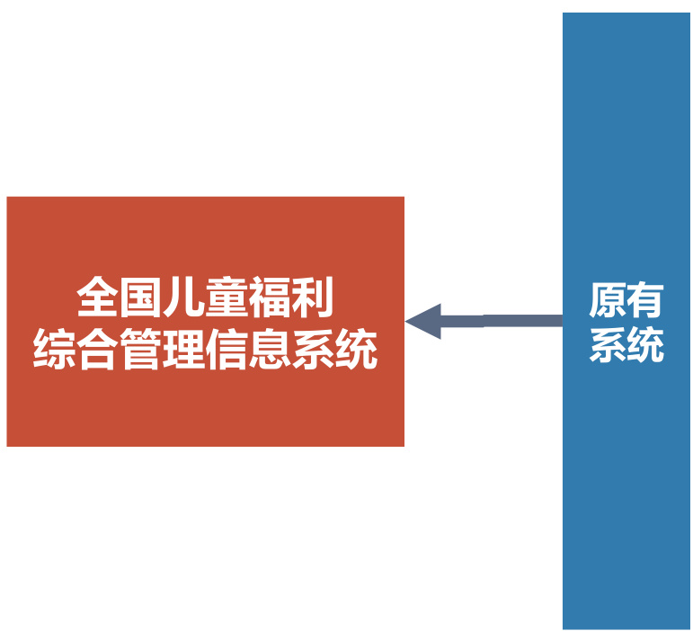  

1.全国村居儿童主任（乡镇督导员）管理系统  
2.全国农村留守儿童和困境儿童信息管理系统  
3.孤残儿童涉外安置信息系统  
4.全国收养登记管理信息系统  
5.全国儿童福利信息管理系统  
6.全国打拐解救儿童寻亲公告平台  

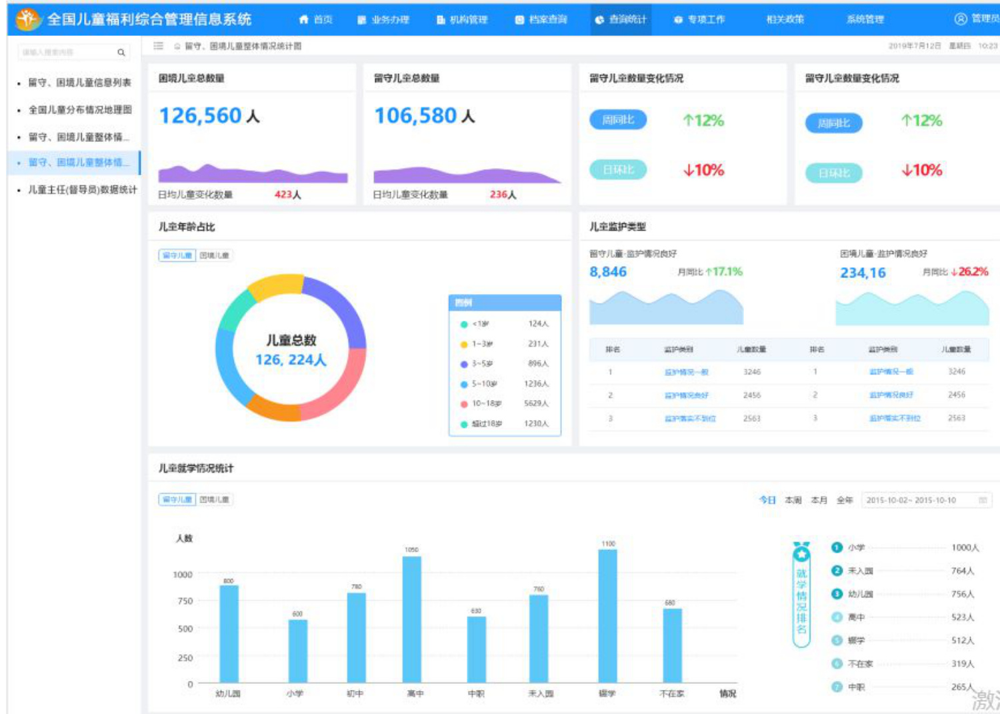  

# 金民工程总体框架－全国养老服务系统  

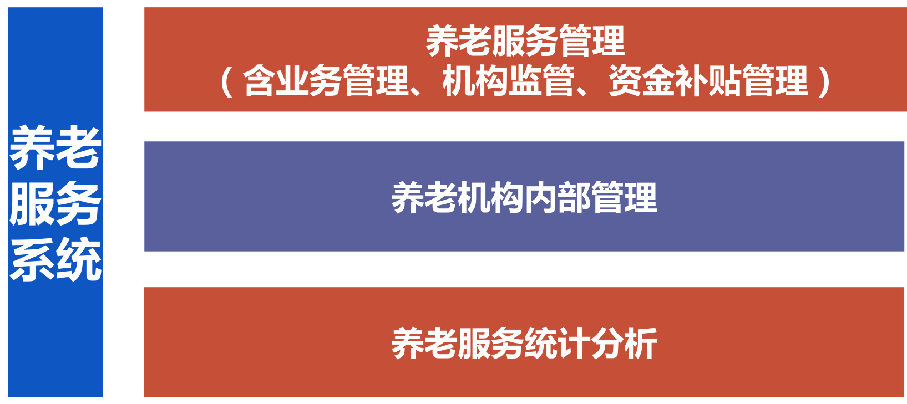  

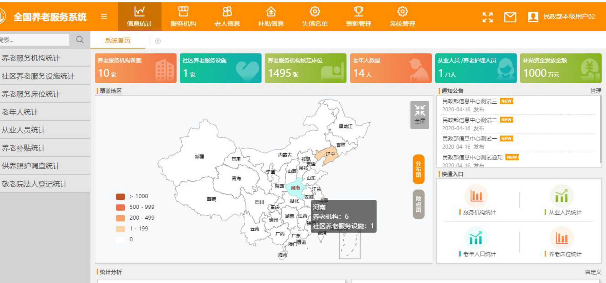  
全国养老服务系统  

# 金民工程总体框架－全国社会工作信息系统  

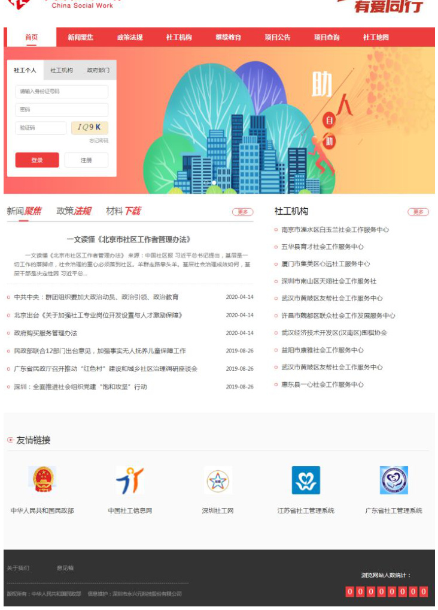  

<html><body><table><thead><tr><td><b>通知公告</b></td><td><b>更多</b></td></tr></thead><tbody><tr><td>国家卫生计生中央宣传部中央</td><td>2020-06-12</td></tr><tr><td>国家发展改革受人民银行民政服</td><td>2020-06-12</td></tr><tr><td>测式</td><td>2020-05-28</td></tr><tr><td>烫试</td><td>2020-05-28</td></tr><tr><td>共有团中史民政部财政部关于.</td><td>2020-05-22</td></tr></tbody></table></body></html>  

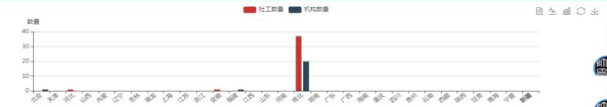  

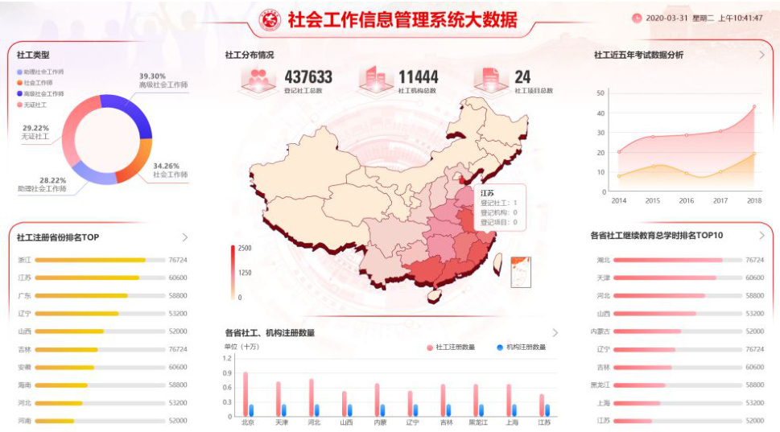  

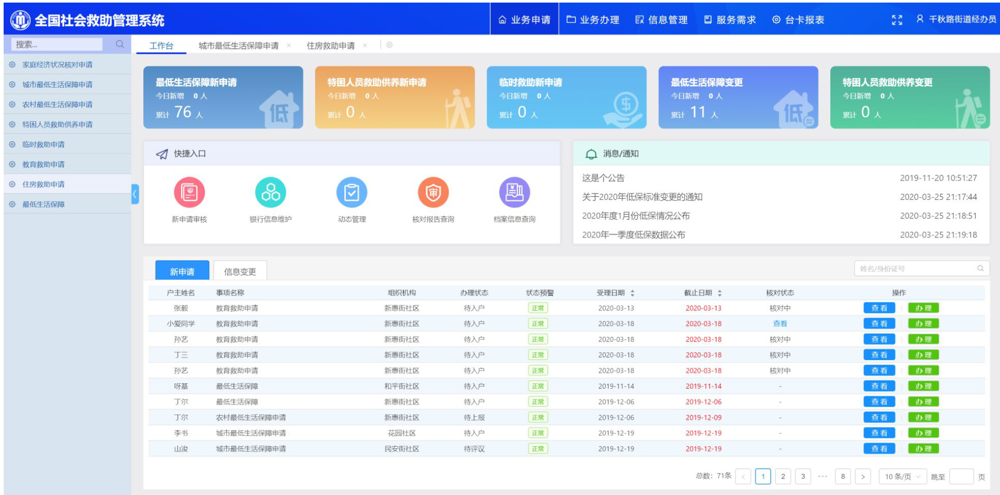  
金民工程总体框架－全国社会救助管理系统  

# 金民工程总体框架－全国志愿服务信息系统  

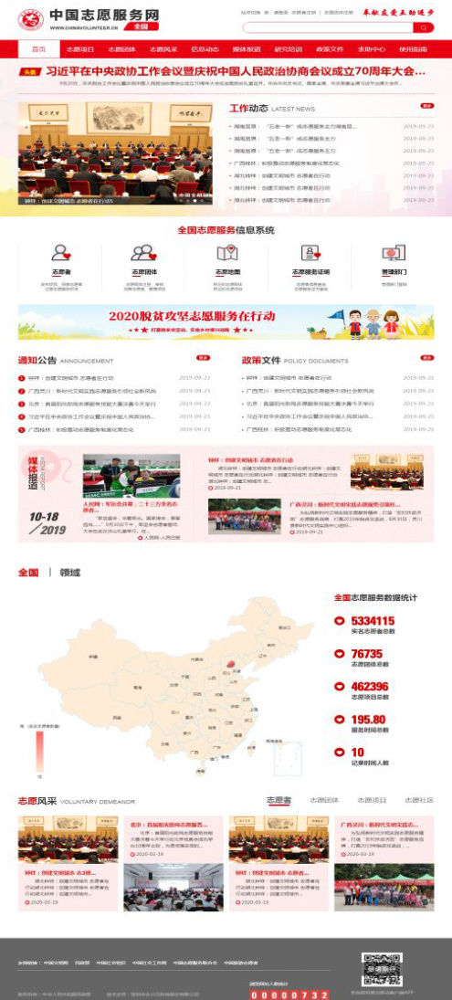  

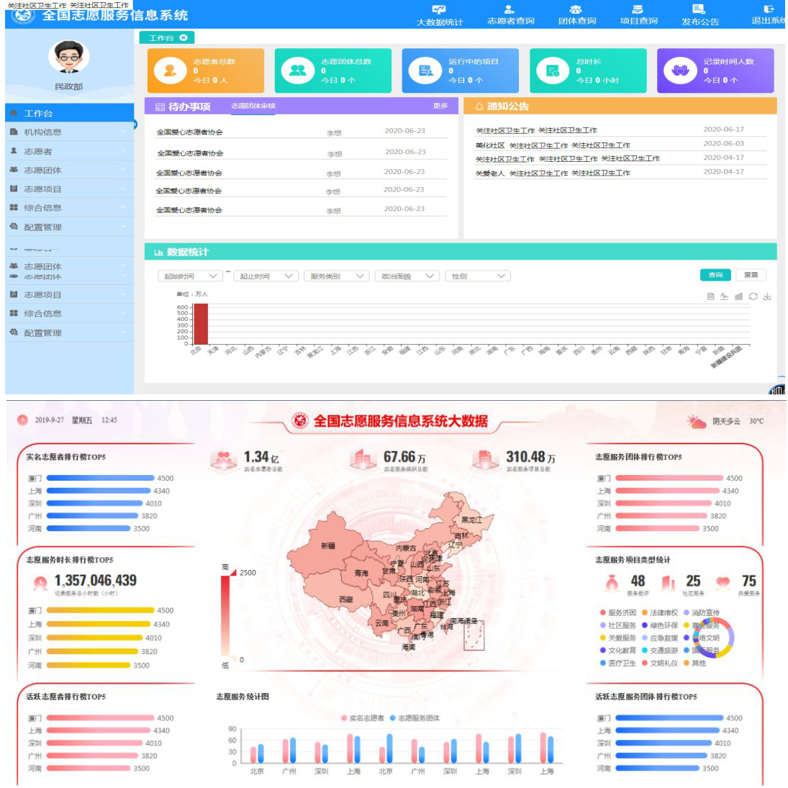  

# 金民工程总体框架－基层政权建设和社区治理信息管理系统  

  

#  

#  

<html><body><table><thead><tr><td><b>4 通知公告</b></td><td><b>更多</b></td></tr></thead><tbody><tr><td>2019年度年报年检工作的函</td><td>2020-04-28</td></tr><tr><td>机动车牌证作废公告</td><td>2020-04-28</td></tr><tr><td>实施70周年征文启事</td><td>2020-04-28</td></tr><tr><td>纪念《中华人民共和国婚姻法》</td><td>2020-04-28</td></tr><tr><td>入境人员心理疏导的通知</td><td>2020-04-28</td></tr></tbody></table></body></html>  

<html><body><table><thead><tr><td><b>业务汇总</b></td><td><b>工作动态</b></td><td><b>典型案例</b></td><td><b>更多</b></td></tr></thead><tbody><tr><td>基层工作切莫陷入事务主义</td><td>于建嵘</td><td>2019-08-25</td><td>2019-08-25</td></tr><tr><td>规则意识的伦理底线</td><td>于建嵘</td><td>2019-08-05</td><td>2019-08-05</td></tr><tr><td>“互联网+”消防综合治理的深圳模式</td><td>连樟文</td><td>理论研究</td><td>2018-08-15</td></tr><tr><td>理论研究</td><td>卫杰夫、李卓庆</td><td>卫杰夫、李卓庆</td><td>2020-03-06</td></tr><tr><td>社会工作发展中的“美美与共”</td><td>王思斌</td><td>王思斌</td><td>2019-10-06</td></tr><tr><td>4-28理论研究</td><td>专家1号</td><td>专家1号</td><td>2020-04-01</td></tr></tbody></table></body></html>  

#  

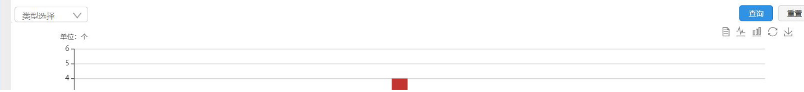  

# 金民工程总体框架－大系统设计  

通过应用集成，实现所有系统统一入口，统一工作门户，用户一次登录便可使用所有系统。（ http://zwxt.mca.gov.cn:8001/casserver/newGate/index.jsp ）  

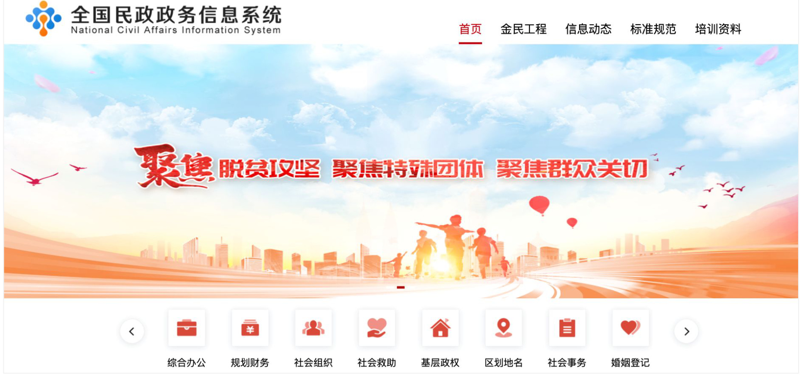  

# 金民工程总体框架－民政一体化政务服务平台  

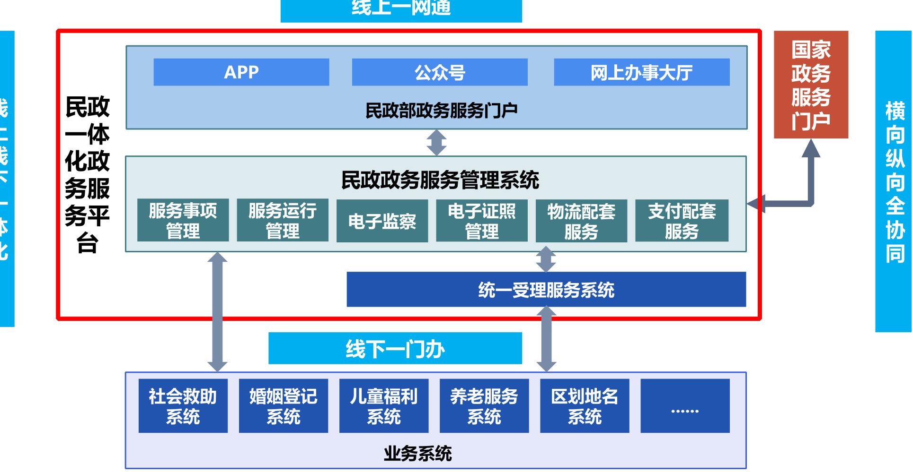  

# 金民工程总体框架－统一服务事项管理  

通过政务服务事项管理模块，实现全国各级民政政务服务事项的动态管理、规范运行；通过一库汇聚，支撑全国范围政务服务事项的一网通办。  

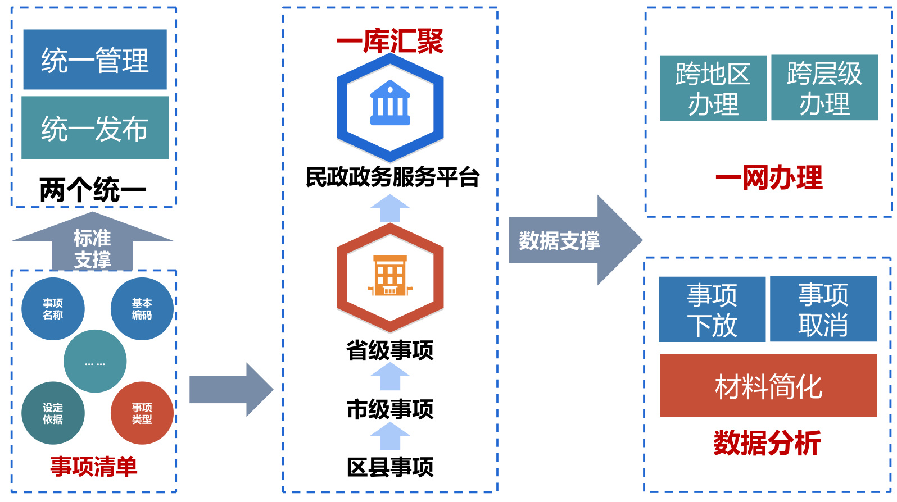  

# 金民工程总体框架－统一政务服务门户  

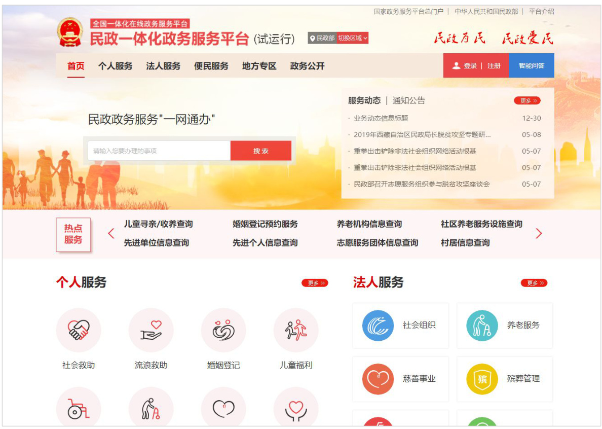  
民政一体化政务服务门户（PC、移动）  

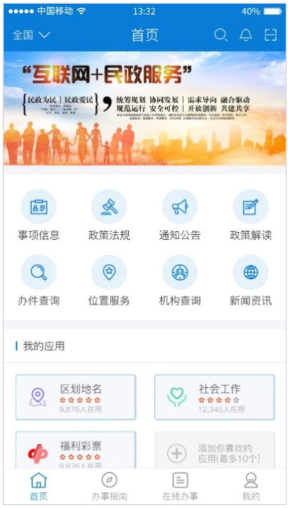  

# 金民工程总体框架－标准规范体系设计  

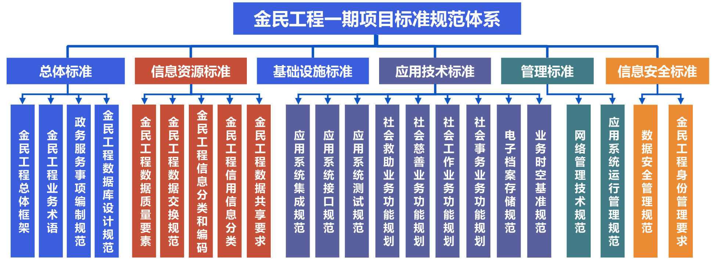  

金民工程标准规范体系包括：总体标准、信息资源标准、基础设施标准、应用技术标准、管理标准、信息安全标准共6大类23项总体性标准，为系统开发、数据交换、业务协同、信息安全和管理等，提供规范性指引，并与应用系统和平台建设相关的85项标准规范，共同构成108项工程标准体系。  

# 标准规范体系设计  

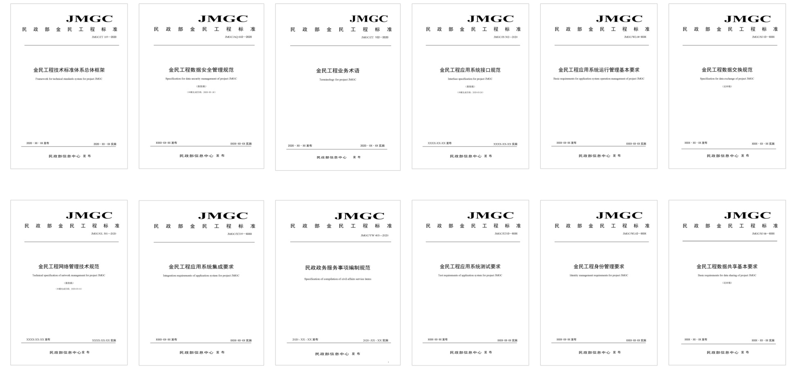  

# 金民工程总体框架－部署和应用模式  

•全国大集中部署模式6级应用：在民政统一云服务平台支撑下，采用物理上全国大集中部署，实现一级部署，部、省、市、县、乡、村6级应用。•部省两级部署模式5级应用：是指系统在部省两级都部署。省级部署的系统可在省级政务云平台或省级自建机房落地，供本省范围内5级用户使用，形成统一的部省联动、业务协同模式。  

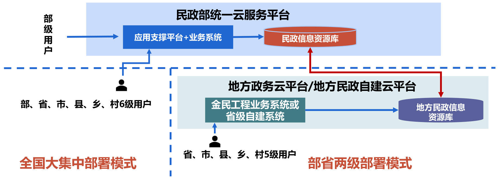  

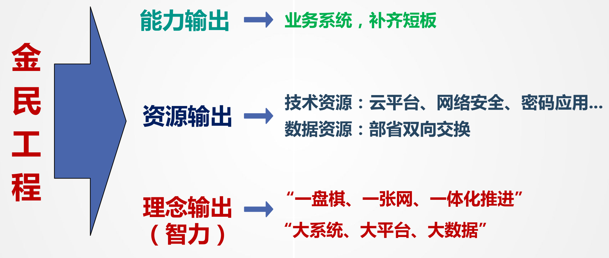  
金民工程总体框架－小结  

# 03 PART THREE  

# 在脱贫攻坚中的应用  

  

  

# 在脱贫攻坚中的应用－整合数据资源  

# 4类内部数据  

1、社会救助：低保、特困、临时  
2、儿童福利：困境儿童、留守儿童、孤儿  
3、社会事务：婚姻登记、殡葬火化、流浪乞讨  
残疾人两项补贴   
4、区划地名：行政区划代码  

# 5类外部数据  

1、扶贫办：建档立卡、边缘人口、返贫人口  
2、卫健委：出生/死亡证明、大病、重病  
3、公安部：人口基本信息  
4、教育部：困难学生学籍信息  
5、残联：残疾人基本信息  

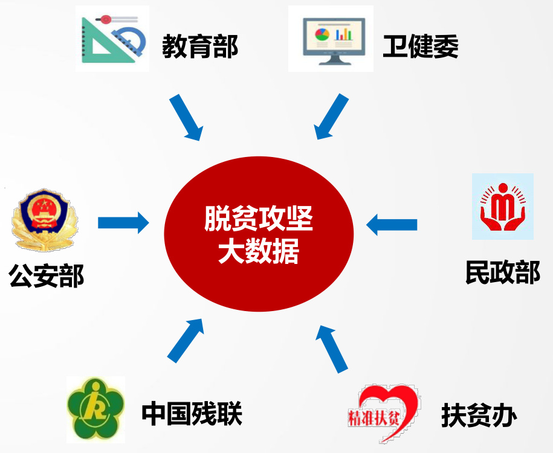  

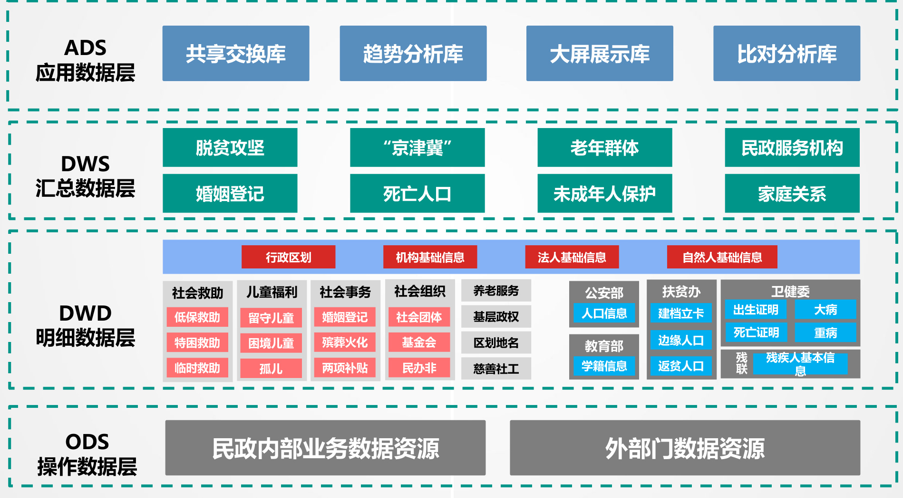  
在脱贫攻坚中的应用－基于“中台”理念的数据分层分类设计  

# 在脱贫攻坚中的应用－规范各层级库表命名  

# DWD层表命名规则： DWD_{d}_{b}_{p}_{c}{i}  

DWD ——标识表所处数据仓库明细数据层  
d ——标识内外部数据域，固定字符  
b ——标识业务数据域，包含民政全业务和外部委接入业务  
p ——标识业务名称/过程，复杂业务过程描述可通过下划线  
进行 二次分割  
c ——标识数据更新周期  
i ——标识数据是全量更新还是增量更新，i表示增量，f表示  
全量  

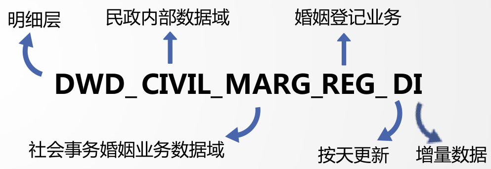  
例1：婚姻登记业务表  

#  

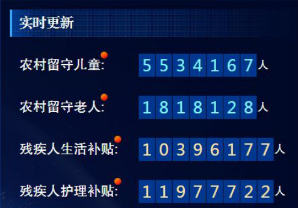  

  

  

  

  

  

# 在脱贫攻坚中的应用－数据分析平台  

  

  

在脱贫攻坚中的应用－数据分析平台  

<html><body><table><thead><tr><td><b>姓名</b></td><td><b>残疾类别</b></td><td><b>疾病名称</b></td><td><b>残疾等级</b></td><td><b>批次</b></td><td><b>地区</b></td></tr></thead><tbody><tr><td>王仁苓</td><td>精神残疾</td><td>脑梗塞</td><td>二级</td><td>202006</td><td>河北省</td></tr><tr><td>张立子</td><td>精神残疾</td><td>三级</td><td>202006</td><td>河北省</td></tr><tr><td>马桂芝</td><td>肢体残疾</td><td>结肠炎慢性胃炎</td><td>四级</td><td>202006</td><td>内蒙古自治区</td></tr><tr><td>王凤兰</td><td>肢体残疾</td><td>三级</td><td>202006</td><td>安徽省</td></tr><tr><td>李信丰</td><td>肢体残疾</td><td>需要髋关节置换的相关疾病(诊断</td><td>四级</td><td>202006</td><td>安徽省</td></tr><tr><td>武德干</td><td>肢体残疾</td><td>胆总管扩张</td><td>三级</td><td>202006</td><td>安徽省</td></tr><tr><td>郑美玲</td><td>肢体残疾</td><td>肺炎球菌感染风湿性关节炎，气管.</td><td>四级</td><td>202006</td><td>安徽省</td></tr><tr><td>吴义生</td><td>肢体残疾</td><td>气管炎</td><td>二级</td><td>202006</td><td>安徽省</td></tr><tr><td>傅义</td><td>肢体残疾</td><td>菌血症</td><td>四级</td><td>202006</td><td>安徽省</td></tr><tr><td>张兴宽</td><td>肢体残疾</td></tr></tbody></table></body></html>  

# 根据不同业务场景，达到的性能水平：  

1、针对单表（千万数据量级）的业务场景，条件查询和统计分析耗时在6-9s；  
2、针对多表关联（不含婚姻数据）的业务场景，条件查询耗时在9-15s  
3、针对多表关联（含婚姻数据）的业务场景，关联查询耗时在26-45s之间  

# 在脱贫攻坚中的应用－“一张图”展示  

  

  
在脱贫攻坚中的应用－“一张图”展示  

# 在脱贫攻坚中的应用－用户画像分析  

以民政社会救助等内部业务数据为基础，关联扶贫办建档立卡、卫健委大重病、公安部人口基本信息等，以民政服务对象（自然人）为中心，分析其社会属性、家庭关系，并进行全生命周期展示，为民政业务人员，业务办理，精准核对服务对象信息提供数据支撑。  

<html><body><table><thead><tr><td><b>基础信息</b></td><td><b>姓名、性别、年龄、民族、出生日期、文化程度、婚姻状态等</b></td></tr></thead><tbody><tr><td>社会属性</td><td>是否残疾、是否大重病、是否纳入低保、是否未脱贫、是否具有返贫风险</td></tr><tr><td>家庭关系</td><td>由户籍、婚姻登记、收养、赡养等信息，计算家庭关系成立的可能性</td></tr><tr><td>全生命周期</td><td>按照时间发展方向，串联各类业务办理，形成人生轨迹</td></tr></tbody></table></body></html>  

# 在脱贫攻坚中的应用－用户画像分析  

  

# 在脱贫攻坚中的应用-用户画像分析（三）  

  

# 04 PART FOUR  

# 信息化工作的体会  

使用推广“三步曲”“聚、通、融”  

  

  
信息化工作的体会－应用系统推广“三步曲”  

# 信息化工作的体会－“聚、通、融”  

  

谢谢！  