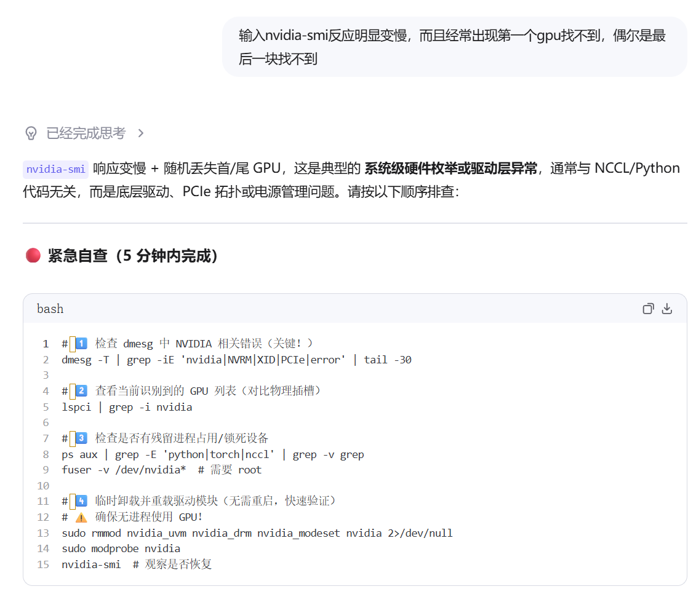
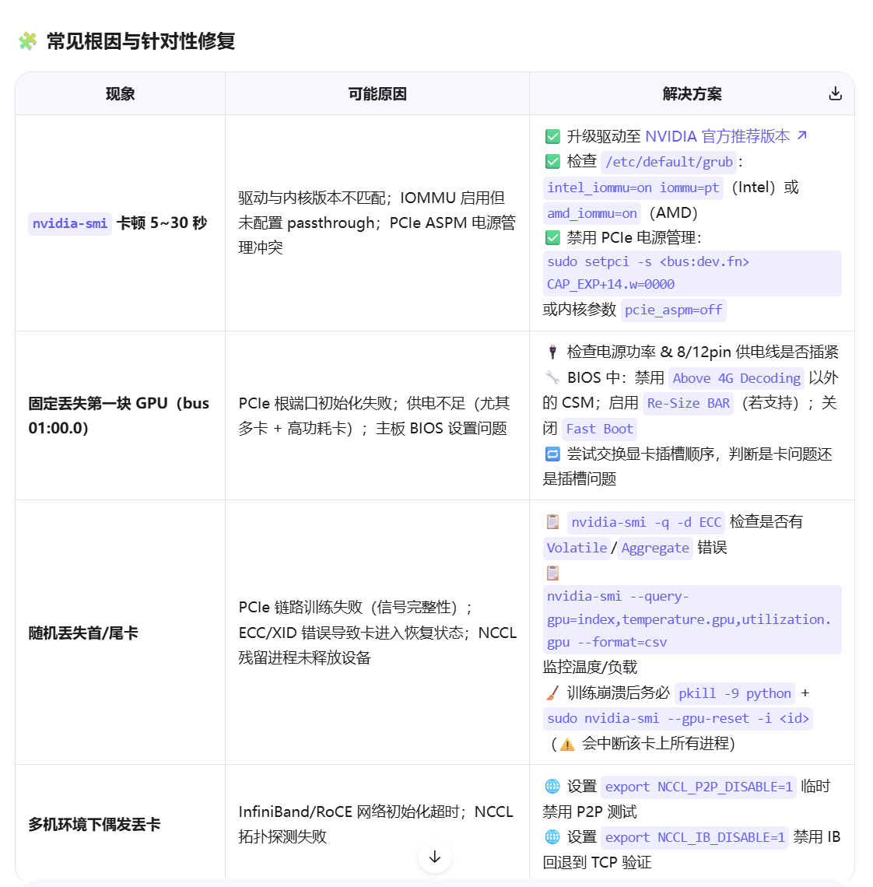
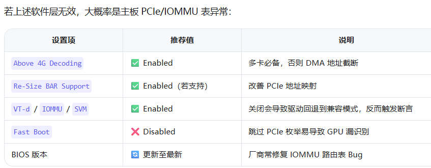

##  深度诊断命令

###  查看每块卡的详细状态（重点关注 "GPU Status" 和 "Persistence-M"）
nvidia-smi -q
sudo nvidia-persistenced --verbose
###  检查 PCIe 链路速度与宽度（降速可能预示接触不良）
sudo lspci -vvv -s 16:00.0 | grep -E 'LnkCap:|LnkSta:'
sudo lspci -vvv -s $(lspci | grep -i nvidia | head -1 | awk '{print $1}') | grep -E 'LnkSta:|Capabilities'

###  dmesg -T | grep -iE 'nvidia|XID|PCIe' | tail -20

###  监控 GPU 初始化过程（配合复现问题）
sudo dmesg -w | grep -i nvidia

###  验证驱动/内核模块一致性
modinfo nvidia | grep version
nvidia-smi --query-gpu=driver_version --format=csv,noheader


## 方案 1：启用 IOMMU Passthrough（官方推荐首选）

```
# 1. 备份原配置（防误改）
sudo cp /etc/default/grub /etc/default/grub.bak

# 2. 编辑 GRUB 配置
sudo nano /etc/default/grub

# 3. 找到 GRUB_CMDLINE_LINUX_DEFAULT 或 GRUB_CMDLINE_LINUX，追加：
# Intel CPU：
GRUB_CMDLINE_LINUX_DEFAULT="... intel_iommu=on iommu=pt"

# 4. 更新 GRUB
sudo update-grub          # Ubuntu/Debian

# 5. 重启
sudo reboot

✅ 重启后验证清单
# 1. 确认内核参数已加载
cat /proc/cmdline | grep -o "iommu=pt"

# 2. 检查 nvidia-smi 是否秒开 & GPU 全量识别
nvidia-smi

# 3. 查看 IOMMU 初始化日志（应无 NVRM 断言）
dmesg | grep -iE "IOMMU|DMAR|AMD-Vi|iova" | tail -5
输出如下信息：
[    6.207878] pci 0000:ff:1e.4: Adding to iommu group 409
[    6.207992] pci 0000:ff:1e.5: Adding to iommu group 409
[    6.208104] pci 0000:ff:1e.6: Adding to iommu group 409
[    6.208227] pci 0000:ff:1e.7: Adding to iommu group 409
[    6.208567] DMAR: Intel(R) Virtualization Technology for Directed I/O

# 4. 开启 Persistence Mode（nvidia-smi秒开）
sudo nvidia-smi -pm ENABLED

永久生效（推荐生产环境使用）
# 安装并启用官方守护进程
sudo apt update
sudo apt install nvidia-compute-utils-580-server
sudo systemctl enable --now nvidia-persistenced 【可能会输出说The unit files have no installation config ...因此无法通过 systemctl enable 直接管理】
sudo nvidia-persistenced --verbose [需要手动启动一次守护进程]
验证是否生效：
新开一个终端，运行：
 检查进程是否存在
ps aux | grep nvidia-persistenced
# 验证服务状态
systemctl status nvidia-persistenced
# 预期：Active: active (running)

###如果出现
nvidia-persistenced.service - NVIDIA Persistence Daemon
     Loaded: loaded (/usr/lib/systemd/system/nvidia-persistenced.service; static)
     Active: inactive (dead)

4月 05 16:26:47 jqkj-H3C-UniServer-R5300-G6 systemd[1]: Started nvidia-persistenced.service - NVIDIA Persistence Daemon.
4月 05 16:26:47 jqkj-H3C-UniServer-R5300-G6 nvidia-persistenced[15673]: Received signal 15
4月 05 16:26:47 jqkj-H3C-UniServer-R5300-G6 systemd[1]: Stopping nvidia-persistenced.service - NVIDIA Persistence Daemon...
4月 05 16:26:47 jqkj-H3C-UniServer-R5300-G6 nvidia-persistenced[15673]: Socket closed.
4月 05 16:26:47 jqkj-H3C-UniServer-R5300-G6 nvidia-persistenced[15673]: PID file unlocked.
4月 05 16:26:47 jqkj-H3C-UniServer-R5300-G6 nvidia-persistenced[15673]: PID file closed.
4月 05 16:26:47 jqkj-H3C-UniServer-R5300-G6 nvidia-persistenced[15673]: The daemon no longer has permission to remove its runtime data directory /var/run/nvidia-persistenced
4月 05 16:26:47 jqkj-H3C-UniServer-R5300-G6 nvidia-persistenced[15673]: Shutdown (15673)
4月 05 16:26:47 jqkj-H3C-UniServer-R5300-G6 systemd[1]: nvidia-persistenced.service: Deactivated successfully.
4月 05 16:26:47 jqkj-H3C-UniServer-R5300-G6 systemd[1]: Stopped nvidia-persistenced.service - NVIDIA Persistence Daemon.

须：
# 1. 停止服务（确保无残留）
sudo systemctl stop nvidia-persistenced

# 2. 强制删除残留的运行时目录和 PID 文件
# 强制删除整个目录及其内容（不要只删文件，要删目录本身）
sudo rm -rf /var/run/nvidia-persistenced
# 确认目录已消失
ls -ld /var/run/nvidia-persistenced
# 预期输出：ls: cannot access ... (No such file or directory)
sudo rm -f /var/run/nvidia-persistenced.pid

# 3. 重新创建目录并赋予正确权限 (关键！)
sudo mkdir -p /var/run/nvidia-persistenced
# 设置所有者为 root:root
sudo chown root:root /var/run/nvidia-persistenced

# 设置权限为 755 (rwxr-xr-x)
sudo chmod 755 /var/run/nvidia-persistenced
# 再次确认权限
ls -ld /var/run/nvidia-persistenced
# 预期输出：drwxr-xr-x 2 root root ... /var/run/nvidia-persistenced
# 前台运行，观察是否报错
sudo nvidia-persistenced --verbose


# 再次测试速度（应稳定在 <1s）
time nvidia-smi

# 查看 GPU 状态列，Persistence-M 应为 "On"
nvidia-smi -q | grep "Persistence-M"


如有问题，更详细的诊断信息
dmesg -T | grep -iE 'nvidia|XID|PCIe' | tail -20
```


## 方案 4：BIOS/主板关键设置检查




sudo lspci -vvv -s $(lspci | grep -i nvidia | head -1 | awk '{print $1}') | grep -E 'LnkSta:|Capabilities'
        Capabilities: [60] Power Management version 3
        Capabilities: [68] MSI: Enable+ Count=1/1 Maskable- 64bit+
        Capabilities: [78] Express (v2) Legacy Endpoint, MSI 00
                LnkSta: Speed 2.5GT/s (downgraded), Width x16
        Capabilities: [b4] Vendor Specific Information: Len=14 <?>
        Capabilities: [100 v1] Virtual Channel
        Capabilities: [250 v1] Latency Tolerance Reporting
        Capabilities: [258 v1] L1 PM Substates
        Capabilities: [128 v1] Power Budgeting <?>
        Capabilities: [420 v2] Advanced Error Reporting
        Capabilities: [600 v1] Vendor Specific Information: ID=0001 Rev=1 Len=024 <?>
        Capabilities: [900 v1] Secondary PCI Express
        Capabilities: [bb0 v1] Physical Resizable BAR
        Capabilities: [c1c v1] Physical Layer 16.0 GT/s <?>
        Capabilities: [d00 v1] Lane Margining at the Receiver <?>
        Capabilities: [e00 v1] Data Link Feature <?>
是正常的吗？


不正常。
这段输出显示你的 NVIDIA 显卡虽然被识别到了，但是 PCIe 链路速度严重降速（downgraded），这通常意味着存在硬件连接、配置或兼容性问题。
以下是详细分析和排查建议：
1. 为什么说不正常？
当前速度 (LnkSta): Speed 2.5GT/s 对应的是 PCIe 1.0 标准。
支持能力 (Capabilities): 输出末尾显示 Physical Layer 16.0 GT/s，这说明你的显卡硬件本身支持 PCIe 4.0。
关键词 downgraded: 这明确表示系统尝试以更高的速度（如 3.0 或 4.0）进行握手，但失败了，最终被迫降级到最低的 1.0 速度以维持连接。
性能影响: PCIe 1.0 x16 的带宽非常低（约 4GB/s 单向），而现代显卡通常需要 PCIe 3.0 x16 (约 16GB/s) 或 PCIe 4.0 x16 (约 32GB/s)。这会导致显卡性能大幅损失，尤其是在需要频繁交换数据的应用中（如深度学习、高分辨率游戏、渲染）。
2. 可能的原因及解决方法
请按照以下顺序进行排查：
A. 物理接触问题（最常见）
原因: 显卡金手指氧化、插槽内有灰尘，或者显卡没有完全插到底。
解决:
关机断电。
拔下显卡，用橡皮擦轻轻擦拭金手指。
清理主板 PCIe 插槽（可用压缩空气）。
重新用力将显卡插紧，确保卡扣扣好。
B. BIOS/UEFI 设置
原因: 主板 BIOS 中 PCIe 速度被手动锁定在了 Gen 1，或者 "Auto" 模式识别错误。
解决:
进入 BIOS 设置。
找到 PCIe 配置选项（通常在 Advanced -> PCIe Configuration 或 Chipset 下）。
将 PCIe Speed 从 Auto 或 Gen1 改为 Gen3 或 Gen4（根据你的显卡和主板支持情况）。
保存重启。
C. 使用了 PCIe 延长线（Riser Cable）
原因: 如果你使用了显卡延长线（常见于 ITX 机箱或矿机），很多廉价的延长线只支持 PCIe 3.0 甚至 1.0/2.0，或者线材质量差导致信号完整性不足，被迫降速。
解决:
尝试直接将显卡插在主板上，不使用延长线。
如果必须使用，请购买支持 PCIe 4.0 的高质量延长线，并在 BIOS 中强制指定对应的 Gen 速度（有时 Auto 会失败，需手动指定 Gen3）。
D. 插槽带宽共享
原因: 某些主板上，特定的 PCIe 插槽会与 M.2 接口或其他 PCIe 插槽共享通道。如果插了多个设备，带宽会被拆分或降速。
解决: 查阅主板说明书，确认你使用的插槽是否是全速 x16 插槽（通常是靠近 CPU 的第一条插槽）。尝试更换到第一条 PCIe x16 插槽。
E. 电源供电不足
原因: 虽然较少见，但如果电源供电不稳定，可能导致 PCIe 链路训练失败。
解决: 确保显卡外接供电线已插好，且电源功率足够。
F. 系统电源管理 (ASPM)
原因: Linux 内核的主动状态电源管理 (ASPM) 有时会导致链路不稳定。
解决: 尝试在 GRUB 启动参数中添加 pcie_aspm=off，然后更新 grub 并重启，观察 lspci 输出是否恢复正常。
3. 如何验证修复？
修复后，再次运行相同的命令：
bash
1
正常的输出应该类似于：
PCIe 3.0 显卡: LnkSta: Speed 8GT/s, Width x16
PCIe 4.0 显卡: LnkSta: Speed 16GT/s, Width x16
且不应该出现 (downgraded) 字样。
总结： 目前的状态是异常的，建议优先检查显卡是否插紧以及BIOS 中的 PCIe 速度设置。