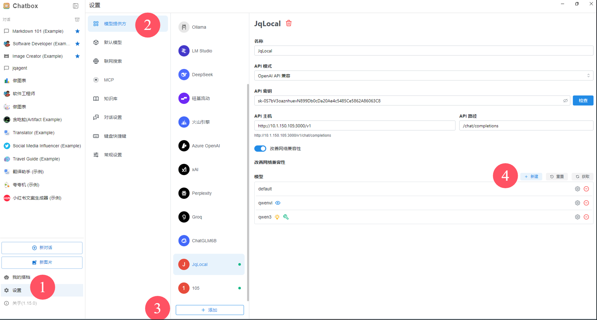
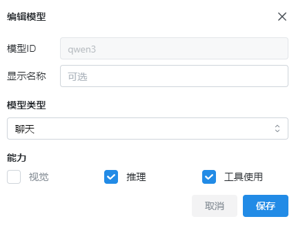
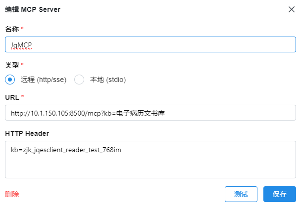
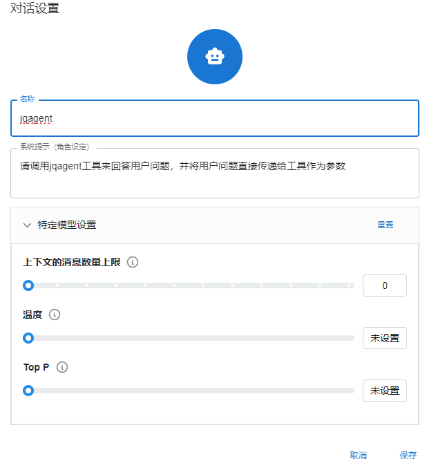

## 运行服务
```
workon test
nohup python /data/projects/JqChatV2/JqChat/jqcode/jq_mcp/jq_mcp_service.py >> /root/JqLogs/jqmcp.log 2>&1 &
tail -f /root/JqLogs/jqmcp.log
```

## 一、 模型设置



## 二、 MCP设置
名称：JqMCP
类型：选择远程 (http/sse)
URL：http://10.1.150.105:8500/mcp?kb=电子病历文书库
HTTP Header：kb=zjk_jqesclient_reader_test_768im
#### 注意：
URL中的 [?kb=电子病历文书库] 部分，是为了传递你的知识库名称，请将'电子病历文书库'替换成'你实际的知识库名称'。【适合中文名称】
HTTP Header：kb=zjk_jqesclient_reader_test_768im，也是为了传递你的知识库名称，请将'zjk_jqesclient_reader_test_768im'替换成'你实际的知识库名称'。【适合英文或字母，中文会报错】

### 测试
点击下方的测试按钮，如果能显示 【工具 jqagent】这样的信息，则表示成功。




## 三、 对话设置如下
名称:jqagent
系统提示词：请调用jqagent工具来回答用户问题，并将用户问题直接传递给工具作为参数
上下文的消息数量上限：0
