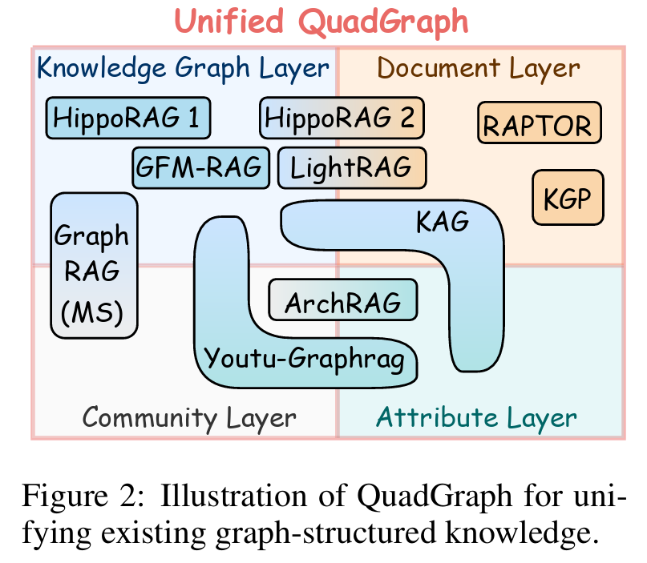
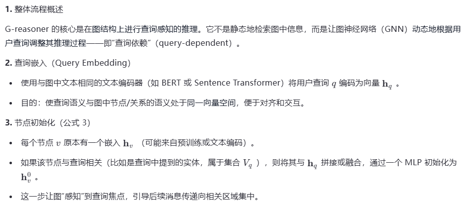
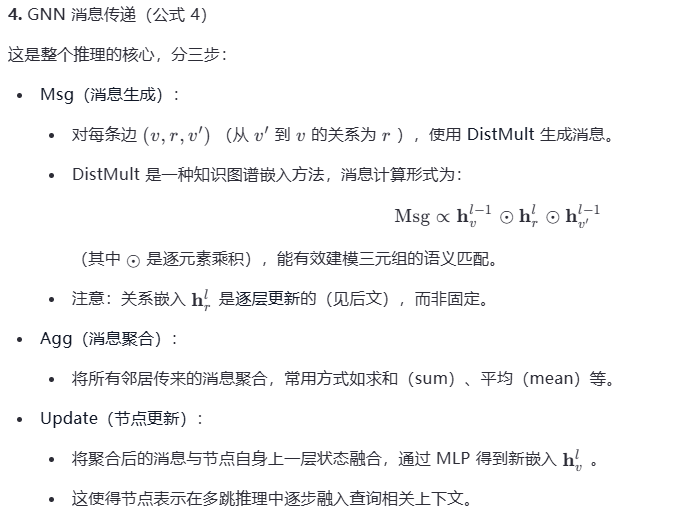
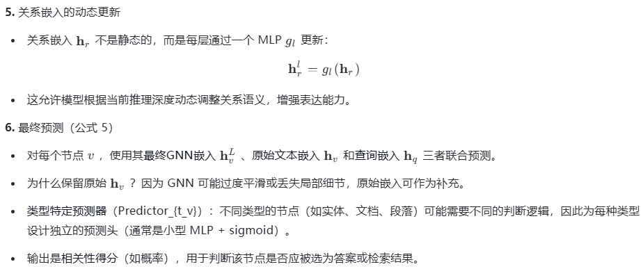

## G-reasoner: Foundation Models for Unified Reasoning over Graph-structured Knowledge
### 链接
#### 论文：https://arxiv.org/abs/2509.24276
#### 代码：https://github.com/RManLuo/gfm-rag

### 笔记
- knowledge graphs: used to represent factual information between entities
- document graphs : used to capture the relationships between documents based on their content similarity or citation links
#### QuadGraph:四层图
- (1) **attribute** layer that captures the common attributes of the nodes; 
- (2) **knowledge** graph layer that represents the entities and their relationships as triples, which stores the structured factual knowledge; 
- (3) **document** layer that contains the unstructured textual information, such as documents and passages; and 
- (4) **community** layer that groups related nodes into communities based on their semantic similarity or structural connectivity to provide global level information.

#### QuadGraph:形式化定义
##### G = (V, E, T, R, S)
- **V**: 节点/实体
-- T: 节点/实体的类型 T = {attribute,entity,document,community}
-- S: 节点/实体的语义特征集 the **set of node semantic features**, such as the name of an entity or the text content of a document
- **E**: 边/关系
-- R: 边类型 
--- relations **between nodes**, (e.g., born in,city of) 
--- special relations **across layers**, (e.g., has attribute,included in,belongs to)

#### GRAPH FOUNDATION MODEL REASONING
##### GNNs
- reasoning over graph-structured data due to their ability of capturing complex relationships and dependencies between nodes
##### GFM-RAG
- GFM-RAG: 
-- graph foundation model (GFM) for reasoning over **knowledge graphs**, which demonstrates the effectiveness of **GNNs** in enhancing LLMs with structured knowledge.
-- specifically designed for **knowledge graphs** and **cannot be directly applied to other types** of graph-structured knowledge with **versatile node types** and **rich text semantics**, such as document graphs or hierarchical graphs
-- only considers the semantics of relations
##### G-reasoner
-- Synergized Reasoning over **Structure** and **Semantics**, further incorporates the rich text semantics of **nodes S** into the reasoning process
###### 构建阶段
--- node embeddings: encode the text features of each node sv ∈ S into node embeddings
--- relation embeddings: encode the text description of each relation using the same text embedding model
###### 检索阶段
-- encodes the query into a **query embedding**
-- a L-layer **query-dependent** GNN is applied to jointly reason over the **graph topology** and **text semantics** via message-passing and make versatile predictions of each node type

#### LANGUAGE FOUNDATION MODEL REASONING
With the unified QuadGraph and GNN-powered foundation model, G-reasoner can efficiently reason over the graph-structured knowledge and provide versatile predictions for arbitrary node types, such as attributes, entities, documents, and communities. This enables **G-reasoner** to flexibly select the **most relevant** information from **different layers** of the graph at **varying granularities**, enhancing LLM reasoning and boosting performance in downstream applications.

#### CONCLUSION
##### G-reasoner: Framework
-- QuadGraph:  unifies diverse graph types into a standardized four-layer graph structure
-- GFM : GNN-poweredgraph foundation model jointly reason over graph topology and text semantics