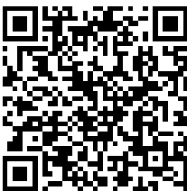
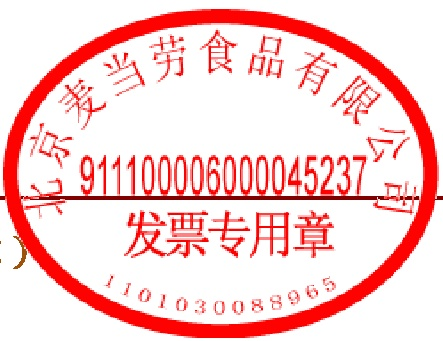

机器编号：661616252116

## 北京增值税电子普通发票

发票代码:011002200611

发票号码:60742331

开票日期:2023年01月30日

校验码:47770 53294 17520 39168

<table border=1 style='margin: auto; width: max-content;'><tr><td style='text-align: center;'>购买方</td><td colspan="5">名称:北京晶奇和一信息科技有限公司纳税人识别号:91110101069561148B地址、电话:北京市东城区王府井大街99号A723-11室 18256953496开户行及账号:</td><td style='text-align: center;'>密码区</td><td colspan="4">*7*14254&gt;1008594116814-987&lt;1&gt;&lt;37239578/72*9&lt;6&lt;4060&gt;+70+6*/36&gt;53+8170/8592116814&lt;88&gt;22/*33+3046*913*8&lt;+62982</td></tr><tr><td colspan="2">货物或应税劳务、服务名称餐饮服务餐饮服务</td><td style='text-align: center;'>规格型号</td><td style='text-align: center;'>单位</td><td style='text-align: center;'>数量</td><td style='text-align: center;'>单价</td><td style='text-align: center;'>75.28</td><td style='text-align: center;'>金额</td><td style='text-align: center;'>税率</td><td style='text-align: center;'>税额</td><td style='text-align: center;'>4.52</td></tr><tr><td colspan="2">合  计</td><td style='text-align: center;'></td><td style='text-align: center;'></td><td style='text-align: center;'></td><td style='text-align: center;'></td><td style='text-align: center;'></td><td style='text-align: center;'>¥75.28</td><td style='text-align: center;'></td><td style='text-align: center;'>¥4.52</td><td style='text-align: center;'></td></tr><tr><td colspan="2">价税合计(大写)</td><td colspan="9">柒拾玖圆捌角(小写)¥79.80</td></tr><tr><td style='text-align: center;'>销售方</td><td colspan="5">名称:北京麦当劳食品有限公司纳税人识别号:911100006000045237地址、电话:北京市东城区王府井大街200号工美大厦七层71室 010-65281188开户行及账号:中国工商银行股份有限公司北京和平里支行 0200004209014442920</td><td style='text-align: center;'>备注</td><td colspan="4"></td></tr></table>

收款人：梁志贤

复核 : 香婉君

开票人:李秀玲

销售方：章

